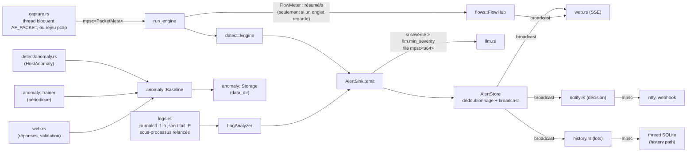

# CLAUDE.md

This file provides guidance to Claude Code (claude.ai/code) when working with code in this repository.

## Projet

Cyward est un agent de détection d'intrusions en Rust (Linux). Il capture le trafic réseau et lit les logs système, lève des alertes via des détecteurs à seuils et statistiques, puis fait trier les alertes importantes par un LLM cyber local (Foundation-Sec-8B-Instruct via Ollama, API compatible OpenAI). Le [README.md](README.md) documente en détail chaque détecteur, la configuration et le déploiement.

Les commentaires, messages de log, textes d'alerte, prompts du LLM et l'interface du dashboard sont **en français** : garder cette langue.

## Règles obligatoires : code bien structuré, commenté et testé

Toute modification de code doit être **bien structurée**, **commentée** et **testée**. Une modification qui ne respecte pas ces trois règles n'est pas terminée.

**Structure et design patterns :**
- **Une responsabilité par module**, et des dépendances qui vont dans un seul sens. État actuel, à préserver :

  | Module | Dépend de |
  |---|---|
  | `detect/` | `alert`, `anomaly`, `capture` (`PacketMeta`), `config` |
  | `anomaly/` | `alert`, `config` |
  | `logs.rs` (et `logs/rules.rs`) | `alert`, `config`, `stats` |
  | `llm.rs` | `alert`, `config`, `stats` |
  | `web.rs` | `alert`, `anomaly`, `flows`, `names`, `stats` |
  | `flows.rs` | `capture` (`PacketMeta`) |
  | `names.rs` | `alert`, `config` |
  | `notify.rs` (et `notify/channels.rs`) | `alert`, `config` |
| `history.rs` (et `history/repository.rs`) | `alert`, `config` |

  Les producteurs d'alertes (`detect/`, `logs.rs`) ne dépendent jamais des consommateurs (`llm`, `web`), et inversement. `anomaly/` (apprentissage du comportement normal) ne dépend ni de `detect`, ni de `llm`, ni de `web` : ce sont eux qui l'utilisent. Seul `main.rs` assemble le tout (racine de composition).
- **Logique pure séparée des entrées/sorties** : le parsing et la décision (`parse_packet`, `parse_dns_query`, `LogAnalyzer::analyze`, `parse_analysis`, les détecteurs, et dans `anomaly/` les caractéristiques, l'Isolation Forest et le diff) ne font aucune I/O. C'est ce qui les rend testables sans réseau, sans fichier, sans LLM. Les I/O (sockets, sous-processus, HTTP) restent en bordure.
- **Favoriser les design patterns déjà en place**, et en réutiliser un plutôt que d'inventer une nouvelle mécanique :

  | Pattern | Où | À réutiliser pour |
  |---|---|---|
  | Strategy (trait + objets `Box<dyn …>`) | `trait Detector`, `Engine` ; `trait LogRule`, `LogAnalyzer` (`logs/rules.rs`) ; `trait Notifier` (`notify/channels.rs`) | Tout nouveau détecteur, règle de log, canal de notification ou analyseur interchangeable |
  | Builder | `Alert::new(...).src(...).dst(...).evidence(...)` | Construire des objets à nombreux champs optionnels |
  | Façade / point d'entrée unique | `AlertSink::emit` ; `Baseline` (`anomaly/baseline.rs`) | Tout ce qui produit des alertes : ne jamais écrire directement dans le store ou la file LLM. Tout ce qui touche au comportement normal passe par `Baseline`, qui applique les garde-fous de validation |
  | Observer (publication/abonnement) | `AlertStore` + `broadcast` → clients SSE, notifications (`notify.rs`), historique (`history.rs`) ; `FlowHub` (`flows.rs`) → onglets Flux | Diffuser des événements à plusieurs consommateurs |
  | Producteur/consommateur (pipeline par canaux) | capture → moteur, sources de logs → analyseur, sink → LLM | Découpler un producteur rapide d'un consommateur lent (canal borné, `try_send` si le producteur ne doit pas bloquer) |
  | Middleware (chaîne de responsabilité) | `auth`, et `write_guard` sur les routes d'écriture (`web.rs`) | Comportements transverses du serveur web ; toute nouvelle route d'écriture va dans le routeur protégé par `write_guard` |
  | Superviseur | `logs::supervise` | Tâche externe à relancer après une panne |
  | Repository | `Storage` (`anomaly/storage.rs`) ; `AlertRepository` (`history/repository.rs`, SQLite) | Toute persistance sur disque : le reste du code ne connaît ni les fichiers ni leur format |

- **Ouvert à l'extension, fermé à la modification** : une nouvelle détection s'ajoute en écrivant une nouvelle implémentation et en l'enregistrant (`Engine::new`), pas en ajoutant des cas dans le code existant.
- **Les types plutôt que des valeurs brutes** : des enums (`Severity`, `AlertKind`, `TriageStatus`, `Proto`) plutôt que des chaînes ou des booléens ; une struct de configuration avec `#[serde(default)]` et `impl Default` par sous-système.
- **Pas d'état global** (ni `static mut`, ni singleton) : l'état partagé passe explicitement en `Arc`, avec des atomiques pour les compteurs et un `Mutex` court pour le reste.
- **Fonctions courtes**, qui font une seule chose et dont le nom le dit ; découper dès qu'une fonction mélange décision et I/O, ou dépasse un écran.
- **Patterns au service de la simplicité** : un pattern se justifie par un besoin réel (plusieurs implémentations, découplage, testabilité). Pas d'abstraction pour une seule implémentation sans besoin prévisible, pas de couche « au cas où ». Préférer les idiomes Rust (traits, enums + `match`, itérateurs, `?`) aux patterns orientés objet transposés tels quels (pas d'émulation d'héritage, pas d'accesseurs inutiles).

**README toujours à jour (obligatoire)** : la section 2 « Architecture du code » du README est la référence de la structure du projet. Toute modification qui ajoute, change ou retire l'un des éléments suivants met à jour cette section **dans la même modification** :
- un fichier ou un dossier → l'arborescence et « Les composants » ;
- une dépendance entre modules → le tableau « Dépendances entre modules » (et celui de CLAUDE.md ci-dessus, qui doit rester cohérent avec lui) ;
- un design pattern, ou un nouvel usage d'un pattern existant → le tableau « Design patterns utilisés » : le pattern, l'endroit du code et le problème qu'il résout dans Cyward.

Le reste du README suit la même règle : détecteurs (section 3), configuration (section 7), API et types d'alerte (section 8), résultat du rejeu (section 11). Une modification dont le README n'est pas à jour n'est pas terminée.

**Diagrammes en Mermaid (obligatoire)** : tout diagramme d'un fichier Markdown (README, `doc/`, CLAUDE.md, skills) s'écrit dans un bloc ` ```mermaid ` (`flowchart`, `sequenceDiagram`, `stateDiagram-v2`…), jamais en art ASCII. Ne sont pas des diagrammes, et restent en texte : les arborescences de fichiers et les exemples de sortie du terminal. Un diagramme ASCII existant qu'on modifie est converti en Mermaid dans la même modification. Les commentaires `//!` du code Rust gardent un schéma texte court, car rustdoc n'affiche pas Mermaid.

**Commentaires** (en français), au niveau de densité du code existant :
- un en-tête `//!` par module, qui explique son rôle et sa place dans le pipeline ;
- un `///` sur chaque structure, champ, fonction et constante, avec l'unité des valeurs (secondes, octets…) ;
- un `//` devant toute logique non évidente : seuils, formules, bornes mémoire, choix de conception. Le commentaire explique **pourquoi**, pas ce que la ligne fait déjà lisiblement ;
- un commentaire d'une ligne au-dessus de chaque test, qui dit ce qu'il vérifie ;
- piège : sur les structures clap de `main.rs` (`Cli`, `Command` et leurs champs), un `///` devient du texte de `cyward --help`. Les notes destinées aux développeurs y vont en `//`.

**Tests :**
- chaque nouvelle fonctionnalité, détecteur, règle de log ou correction de bug a des tests unitaires dans son module (`#[cfg(test)] mod tests`), avec au moins un cas **positif** (ça détecte) et un cas **négatif** (le trafic ou les logs normaux ne déclenchent rien) ;
- une correction de bug commence par un test qui reproduit le bug ;
- avant de considérer le travail fini, lancer `cargo test` (tout doit passer) et `cargo clippy --all-targets` (aucun avertissement) ;
- toute modification de la détection se vérifie aussi par le rejeu de `examples/gen_attacks.rs` avec `-c examples/rejeu.toml`, qui doit toujours donner 8 alertes. Si un nouveau détecteur est ajouté, ajouter son scénario au générateur et mettre à jour le nombre attendu ici et dans le README ;
- toute modification du dashboard se vérifie dans un navigateur, après recompilation (la page est embarquée dans le binaire).

## Commits git : Conventional Commits (obligatoire)

Chaque message de commit suit la spécification [Conventional Commits](https://www.conventionalcommits.org/fr/v1.0.0/) :

```
<type>(<portée optionnelle>): <description courte, en français, à l'impératif ou au nom>

<corps optionnel : le pourquoi, en français>

<pieds optionnels : BREAKING CHANGE: …, Co-Authored-By: …>
```

- **Types** : `feat` (fonctionnalité), `fix` (correction de bug), `docs` (documentation seule), `test` (tests seuls), `refactor` (ni fonctionnalité ni correction), `perf`, `style`, `build` (Cargo, Dockerfile, compose), `ci`, `chore`. Toujours `docs`, jamais `doc`.
- **Portée** facultative, en minuscules, nommée d'après le module ou la zone touchés : `feat(detect): …`, `fix(web): …`, `docs(readme): …`, `build(docker): …`.
- **Rupture de compatibilité** (configuration, API ou format persisté) : `!` après le type ou la portée (`feat(config)!: …`) **et** un pied `BREAKING CHANGE: <ce qui change et comment migrer>`.
- Un commit = un type. Si une modification mélange une fonctionnalité et une correction sans rapport, en faire deux commits.
- Première ligne de 72 caractères au plus, sans point final.

## Skills du projet

Dans `.claude/skills/`, à utiliser plutôt que de réinventer la démarche :

| Skill | Rôle |
|---|---|
| `/verifier` | Vérification complète avant de déclarer un travail fini : en-têtes `//!`, build, clippy `-D warnings`, tests, rejeu exigeant exactement les alertes attendues (`check.sh`, `--docker` en option) |
| `/nouveau-detecteur` | Ajout d'un détecteur réseau : règles du chemin critique, étapes (config, `AlertKind`, `Engine`, tests, scénario, docs), modèle de code testé |
| `/nouvelle-regle-log` | Ajout d'une règle sur les logs : choix entre règle de config et règle en Rust, tests sur de vraies lignes |
| `/revue` | Revue de code senior avec la grille propre à Cyward (structure et design patterns, temps des paquets, seuils `==`, mémoire bornée, sécurité du dashboard et du LLM) |

Le nombre d'alertes attendues au rejeu est défini par `EXPECTED_TITLES` dans `.claude/skills/verifier/check.sh` : le mettre à jour quand un scénario est ajouté à `examples/gen_attacks.rs`.

## Commandes

```bash
cargo build                      # aucune dépendance système (ni libpcap ni OpenSSL)
cargo test                       # tous les tests (unitaires, dans chaque module)
cargo test detect::scan          # tests d'un module
cargo test detects_ssh_bruteforce   # un seul test (filtre sur le nom)
cargo clippy --all-targets       # doit rester sans avertissement
```

Test de bout en bout sans réseau ni droits : générer un pcap d'attaques simulées puis le rejouer. Avec `examples/rejeu.toml` (liste de menaces d'exemple, passerelle protégée), le rejeu doit produire 8 alertes (balise C2 ×12, force brute, scan, balayage, tunnel DNS, IP listée, usurpation ARP, volume) ; sans, 7 (pas de liste de menaces) :

```bash
cargo run --example gen_attacks -- /tmp/attaques.pcap
cargo run -- -c examples/rejeu.toml replay /tmp/attaques.pcap            # affiche les alertes et quitte
cargo run -- -c examples/rejeu.toml replay /tmp/attaques.pcap --serve    # garde dashboard + triage LLM actifs
```

Docker (Linux) : `docker compose build cyward` puis `docker compose run --rm --no-deps cyward`. Cette commande lance l'agent sans Ollama et sans télécharger le modèle de 5 Go. Le service tourne en `network_mode: host`, avec uniquement `NET_RAW`/`NET_ADMIN` et le journal de l'hôte monté, donc la capture live fonctionne sans `setcap`. La config du conteneur est `docker/cyward.toml`, distincte de `config.example.toml`. Si une dépendance est ajoutée, la couche de cache du `Dockerfile` (faux `main.rs`) suffit ; si un nouveau dossier est embarqué via `include_str!`, il faut ajouter son `COPY`.

La capture live (`cyward run`) exige `sudo setcap cap_net_raw,cap_net_admin=eip target/<profil>/cyward`, à refaire **après chaque build**. `run --no-capture` (logs seuls) n'en a pas besoin. `check-llm` vérifie le modèle avec une alerte d'exemple. Le dashboard écoute par défaut sur `127.0.0.1:8080` (`web.listen`).

## Architecture

Pipeline assemblé dans `main.rs` :



**Apprentissage du comportement normal** (`src/anomaly/`, désactivé par défaut) : conception et garde-fous dans `doc/conception-normalite.md`, à lire avant d'y toucher. `baseline.rs` porte la Façade et les garde-fous ; `baseline/samples.rs` le journal des échantillons (événements, rejeu, rétention, compaction) ; `baseline/status.rs` les vues renvoyées à l'API ; l'explication des anomalies (`explain`) est dans `features.rs`. Invariants à préserver :
- rien n'entre dans le comportement normal sans validation humaine : une fenêtre `flagged` n'est jamais apprise tant qu'elle est sans réponse, un modèle candidat n'est activé qu'après `decide` (sauf diff vide), aucun apprentissage n'est lancé tant qu'un candidat attend ;
- les fenêtres touchées par une alerte à règles (`!AlertKind::is_learning()`) sont exclues de l'apprentissage (`trainer::tainted_by_rules`) ;
- le LLM peut suggérer un motif, jamais valider ;
- l'Isolation Forest isole immédiatement une valeur hors de la plage vue à un nœud (correctif du « masquage », voir `iforest.rs`) ; le diff ignore le bruit de seuil (2 × `contamination`, au moins 3 fenêtres) ;
- le verrou de `Baseline` n'est jamais tenu pendant un calcul long ni une écriture disque, car le moteur le prend à chaque fin de fenêtre : apprentissage en trois temps (copie sous verrou, calcul hors verrou, publication) avec le drapeau `training`, sauvegarde préparée sous verrou (`prepare_save`) puis écrite hors verrou, appelée via `trainer::save` (thread bloquant) depuis le code asynchrone ;
- les échantillons sont persistés en journal d'ajouts (`samples.jsonl`, `SampleEvent`) : toute modification d'un échantillon doit pousser l'événement correspondant dans `pending`, sinon elle est perdue au redémarrage. Tout autre changement d'état persisté met `meta_dirty` à vrai ;
- les données de test de l'apprentissage doivent varier de façon continue (`model::tests::sample`) : des valeurs répétées faussent le seuil par des ex aequo.

Points qui demandent de lire plusieurs fichiers pour être compris :

- **Temps des paquets, pas l'horloge murale.** Les détecteurs raisonnent sur `PacketMeta.ts`, horodatage de capture ou du pcap. C'est ce qui rend le rejeu déterministe : ne pas introduire `SystemTime::now()` dans `detect/`.
  - `Engine::process` appelle `tick` quand le temps des paquets avance d'une seconde.
  - En live, `run_engine` ajoute un tick sur horloge murale pour les périodes sans trafic.
  - En fin de rejeu, un tick final à `last_ts + 3600` clôt les fenêtres ouvertes (nécessaire au détecteur de volume).
- **Émission « une fois par seuil » + dédoublonnage central.** Les détecteurs émettent quand un compteur atteint *exactement* le seuil (`== threshold`), donc une fois par fenêtre. `AlertStore::push` fusionne les alertes de même empreinte arrivant dans `alert_cooldown_secs` : il incrémente `count` et met à jour `last_seen`, `evidence` et la sévérité maximale.
  - L'empreinte par défaut est `kind|src|dst` ; `.fingerprint()` permet de la surcharger.
  - Seule une alerte *nouvelle* part au LLM.
  - `Beaconing` ré-émet volontairement à chaque nouvelle balise régulière pour que le compteur monte.
- **`AlertSink` est le seul point d'entrée** des alertes. Les détecteurs réseau et le `LogAnalyzer` ne touchent jamais directement au store ni à la file LLM.
- **Le LLM n'est jamais sur le chemin critique.**
  - `llm.rs` traite une alerte à la fois.
  - Une tâche `health_loop` sonde `GET /models` toutes les 30 s et met à jour `Stats.llm_online`.
  - Tant que le serveur est hors ligne, les alertes restent `Pending` ; elles ne sont pas marquées en échec.
  - Le prompt inclut jusqu'à 8 alertes récentes impliquant les mêmes hôtes, comparées sans le port grâce à `host_part`.
  - `parse_analysis` est volontairement tolérant : il extrait le JSON entouré de texte, accepte une confiance en `"85%"` et un champ `mitre` en chaîne simple.
- **Mémoire bornée.** Tout l'état des détecteurs est en `HashMap` purgées dans `tick`, avec des plafonds (`MAX_TRACKED` dans beacon et arp, `MAX_SEEN` dans threat, `MAX_SCAN_ENTRIES` et `MAX_BRUTEFORCE_COUNTERS` dans scan, 10 000 sources dans synflood, purge des échecs dans logs). Un plafond se rend testable par un champ (`max_entries`, `max_counters`) initialisé à la constante et réduit dans les tests. L'`AlertStore` garde 5 000 alertes. Tout nouvel état doit avoir sa purge.
- **Historique des alertes** (`src/history.rs`, désactivé tant que `history.path` est vide). Il recharge le store au démarrage (`AlertStore::restore`) puis écrit par lots depuis un thread dédié : ne jamais écrire en base depuis `emit` ni sous le verrou du store. La taille est bornée par âge et par nombre, avec une purge anticipée après `max_alerts / 10` alertes nouvelles (inondation). Le rejeu n'y écrit jamais.
- **Interne / externe.** `DetectionConfig::is_local` (basé sur `local_networks`) détermine :
  - la sévérité des scans (source interne = mouvement latéral = High) ;
  - les flux suivis par `Beaconing` et `Volume` (interne → externe uniquement).
  Pour cette raison, plusieurs détecteurs reçoivent une copie de toute la `DetectionConfig`.
- **Capture.**
  - `pnet_datalink` (AF_PACKET, pur Rust) pour le live ; `pcap-file` v2 pour le rejeu. Le rejeu gère Ethernet, Linux SLL et IP brut, mais pas pcapng.
  - Le parsing passe par `etherparse::SlicedPacket` ; la question DNS est décodée à la main dans `parse_dns_query`.
  - Les trames ARP donnent un `PacketMeta` avec `proto = Proto::Arp` (src/dst = IP de l'émetteur et IP visée) et `arp: Some(ArpInfo)`. Un détecteur qui compte du trafic IP doit les écarter (`volume`, `anomaly` le font).
  - Les listes de menaces sont la seule lecture de fichier de `detect/` : `threat::Blocklist::load`, appelée une fois par `Engine::new` (qui renvoie donc un `Result`).
  - La capture fait `try_send` et compte les pertes dans `Stats.dropped` plutôt que de bloquer.
  - Sans `capture.interface`, `pick_interface` prend l'interface de la route par défaut (`/proc/net/route`).

## Ajouter un détecteur réseau

1. Créer `src/detect/<nom>.rs` qui implémente `Detector` (`on_packet`, et `tick` pour la purge et la clôture des fenêtres), puis l'enregistrer dans `Engine::new` (`detect/mod.rs`).
2. Ajouter sa struct de config dans `config.rs`. Toutes les structs ont `#[serde(default)]` et un `impl Default` qui porte les valeurs par défaut ; reporter la section dans `config.example.toml`.
3. Ajouter si besoin une variante à `AlertKind`. Elle est sérialisée en snake_case, et le dashboard l'affiche en remplaçant `_` par un espace.
4. Tester avec `detect::testutil::{syn, dns}` (constructeurs de `PacketMeta`), y compris un cas négatif. Ajouter éventuellement le scénario à `examples/gen_attacks.rs`.
5. Mettre à jour les tableaux du README (détecteurs, configuration, types d'alerte).

Les règles de logs vivent dans `logs/rules.rs` : une struct par règle qui implémente `LogRule` (ou un `Pattern` pour une regex unique sans état), enregistrée dans `LogAnalyzer::new` ; `logs.rs` ne contient que les sources (sous-processus) et le décodage des lignes. Particularité sshd : une même tentative produit `Invalid user …` **et** `Failed password for invalid user …`. Seule la seconde ligne compte comme un échec ; la première sert uniquement à collecter les noms de compte.

## Dashboard

`assets/index.html` est une page unique en JS vanilla, avec deux onglets : Alertes et Flux. L'onglet Flux dessine sur un `<canvas>` (texte par `fillText`, jamais interprété) et n'ouvre `/api/flows` que lorsqu'il est affiché, car le moteur ne compte le trafic que s'il a un abonné (`FlowHub::is_watched`, consulté une fois par seconde, car il prend un verrou). Pour le voir en action : `replay … --serve --speed 20`, qui attend l'ouverture de l'onglet.

La page est **embarquée à la compilation** par `include_str!` dans `web.rs`. Après une modification, il faut recompiler et relancer le serveur pour la voir.

Les données affichées viennent du réseau et des logs, donc potentiellement d'un attaquant. Le DOM est construit uniquement via le helper `el()` (textContent) : ne jamais utiliser `innerHTML` avec des données d'alerte.

Le jeton optionnel (`web.token`) est vérifié par un middleware axum, en `?token=` ou `Authorization: Bearer`. Le JS le propage aux appels `fetch` et `EventSource` via `q()`.
