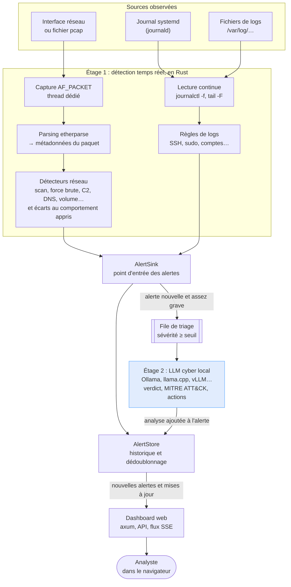

<p align="center">
  
</p>

# Cyward

**Cyward** est un agent de détection d'intrusions écrit en Rust. On l'installe sur une machine du réseau à protéger. Il observe le trafic réseau et les journaux système, lève des alertes en temps réel quand il repère une attaque ou un comportement anormal, puis fait analyser chaque alerte importante par un **modèle de langage open source spécialisé en cybersécurité**, exécuté en local.

Tout reste sur ta machine : aucune donnée réseau ni aucun log ne part vers un service externe.

---

## Sommaire

1. [Principe de fonctionnement](#1-principe-de-fonctionnement)
2. [Architecture du code](#2-architecture-du-code)
3. [Les détecteurs en détail](#3-les-détecteurs-en-détail)
4. [Le modèle de langage (triage IA)](#4-le-modèle-de-langage-triage-ia)
5. [Installation](#5-installation)
6. [Utilisation](#6-utilisation)
7. [Configuration complète](#7-configuration-complète)
8. [Le dashboard et l'API](#8-le-dashboard-et-lapi)
9. [Où déployer l'agent dans le réseau](#9-où-déployer-lagent-dans-le-réseau)
10. [Lancer l'agent comme service systemd](#10-lancer-lagent-comme-service-systemd)
11. [Tests et simulation d'attaques](#11-tests-et-simulation-dattaques)
12. [Réduire les faux positifs](#12-réduire-les-faux-positifs)
13. [Dépannage](#13-dépannage)
14. [Sécurité de l'agent lui-même](#14-sécurité-de-lagent-lui-même)
15. [Limites connues](#15-limites-connues)
16. [Pistes d'évolution](#16-pistes-dévolution)
17. [Licence](#17-licence)

---

## 1. Principe de fonctionnement



Le système fonctionne en deux étages.

**Étage 1 : détection rapide, en Rust.** Chaque paquet est réduit à ses métadonnées : adresses, ports, drapeaux TCP, taille et nom DNS demandé. Le contenu n'est jamais conservé. Des détecteurs statistiques et à seuils traitent ces métadonnées au fil de l'eau. En parallèle, les journaux système sont lus en continu et comparés à des règles. Cet étage traite des dizaines de milliers de paquets par seconde sur un CPU ordinaire.

**Étage 2 : analyse par un modèle de langage.** Les alertes dont la sévérité dépasse un seuil, `medium` par défaut, sont envoyées une par une au modèle. Il reçoit l'alerte, ses preuves et les autres alertes récentes impliquant les mêmes adresses. Il renvoie :

- un verdict : malveillant, suspect ou bénin ;
- un indice de confiance ;
- une explication en langage clair ;
- les techniques MITRE ATT&CK correspondantes ;
- des recommandations concrètes.

**Pourquoi ne pas tout envoyer au modèle ?** Un modèle de 8 milliards de paramètres sur CPU produit quelques mots par seconde. Il ne peut pas suivre un flux de paquets. En revanche, il excelle à contextualiser une alerte déjà isolée : faire le lien entre un scan et une force brute venant de la même IP, distinguer une sauvegarde nocturne d'une exfiltration, proposer une réponse. La détection reste donc temps réel, et l'IA apporte le jugement.

---

## 2. Architecture du code

```
cyward/
├── Cargo.toml
├── config.example.toml        # configuration commentée, toutes valeurs par défaut
├── Dockerfile, compose.yaml   # image et déploiement Docker
├── docker/cyward.toml         # configuration utilisée par l'image Docker
├── LICENSE                    # Apache 2.0
├── CLAUDE.md                  # règles du projet pour Claude Code
├── doc/
│   └── conception-normalite.md  # conception de l'apprentissage du comportement normal
├── .claude/skills/            # skills : verifier, nouveau-detecteur, nouvelle-regle-log, revue
├── assets/
│   ├── index.html             # dashboard (embarqué dans le binaire à la compilation)
│   └── logo.svg, logo-wordmark.svg, favicon.svg
├── examples/
│   └── gen_attacks.rs         # générateur de pcap d'attaques simulées
└── src/
    ├── main.rs                # CLI, assemblage des tâches, boucle du moteur   ⑤ ⑧
    ├── banner.rs              # bannière de démarrage (logo, version, résumé de la config)
    ├── config.rs              # structures de configuration (TOML + valeurs par défaut)
    ├── alert.rs               # modèle d'alerte, AlertStore, AlertSink         ② ③ ④
    ├── stats.rs               # compteurs exposés au dashboard
    ├── capture.rs             # capture live, rejeu pcap, parsing des paquets  ⑤
    ├── detect/
    │   ├── mod.rs             # trait Detector et moteur                       ①
    │   ├── scan.rs            # scan, balayage, force brute, inondation SYN    ①
    │   ├── beacon.rs          # balises périodiques (C2)                       ①
    │   ├── volume.rs          # volume sortant anormal (exfiltration)          ①
    │   ├── dns.rs             # DNS à forte entropie, tunnel DNS               ①
    │   └── anomaly.rs         # écarts au comportement normal appris           ①
    ├── anomaly/               # apprentissage du comportement normal
    │   ├── features.rs        # 12 caractéristiques par machine et par fenêtre
    │   ├── iforest.rs         # Isolation Forest (sans dépendance)
    │   ├── model.rs           # échantillons et modèles versionnés
    │   ├── diff.rs            # ce qu'un nouveau modèle accepterait de plus
    │   ├── baseline.rs        # cycle de vie et garde-fous de validation        ③
    │   ├── baseline/
    │   │   ├── samples.rs     # journal des échantillons, rétention, compaction
    │   │   └── status.rs      # état renvoyé au dashboard (GET /api/baseline)
    │   ├── storage.rs         # persistance sur disque                          ⑨
    │   └── trainer.rs         # apprentissages périodiques                      ⑤
    ├── logs.rs                # sources de logs (journalctl, tail -F)          ⑤ ⑦
    ├── logs/
    │   └── rules.rs           # trait LogRule et règles d'analyse              ①
    ├── llm.rs                 # client du modèle, prompt, décodage du verdict  ⑤
    └── web.rs                 # serveur HTTP, API JSON, flux SSE               ④ ⑥
```

Les numéros en fin de ligne renvoient aux [design patterns](#design-patterns-utilisés) mis en œuvre dans le fichier.

### Les composants

**`main.rs`** — racine de composition ⑧, consommateur du pipeline ⑤
- Lit la ligne de commande et la configuration, crée les composants et les relie (canaux, `Arc` partagés).
- `run_engine` consomme les paquets et transmet les alertes produites à l'`AlertSink`.

**`capture.rs`** — producteur du pipeline ⑤
- **Capture live** : utilise `pnet_datalink`, qui ouvre une socket `AF_PACKET`. Cette crate est en pur Rust, sans dépendance à libpcap. La lecture tourne dans un thread dédié et envoie des `PacketMeta` au moteur par un canal borné (`capture.queue_size`). Si le moteur ne suit pas, les paquets sont abandonnés plutôt que de bloquer la capture, et le compteur « Perdus » augmente.
- **Rejeu** : lit un fichier pcap classique avec `pcap-file`. Les types de lien gérés sont Ethernet, Linux SLL (`tcpdump -i any`) et IP brut.
- **Parsing** : assuré par `etherparse` ; la question DNS est extraite à la main.

**`detect/`** — Strategy ①
- Sept stratégies : six détecteurs à règles, plus `HostAnomaly` qui alimente l'apprentissage du comportement normal (s'il est activé).
- Chaque détecteur implémente :
  ```rust
  trait Detector {
      fn on_packet(&mut self, p: &PacketMeta, out: &mut Vec<Alert>);
      fn tick(&mut self, now: f64, out: &mut Vec<Alert>);   // ~1 fois par seconde
  }
  ```
- Les détecteurs raisonnent sur **l'horodatage des paquets**, pas sur l'horloge murale. Le rejeu d'un pcap donne donc exactement les mêmes résultats que la capture d'origine.
- `tick` sert à clore des fenêtres de temps et à purger l'état ancien, ce qui borne la mémoire.
- Les IP de la `whitelist` sont ignorées en tant que source.

**`logs.rs`** — producteur/consommateur ⑤, superviseur ⑦
- Lance `journalctl -f -o json` et/ou `tail -F` sur les fichiers configurés, et relance la commande si elle s'arrête.
- Les lignes, décodées en `LogLine`, passent au `LogAnalyzer` (`logs/rules.rs`, Strategy ①).
- Chaque règle implémente `trait LogRule { fn check(&mut self, line: &LogLine, out: &mut Vec<Alert>); }` et garde son propre état. Par exemple, `SshAuth` mémorise par IP l'historique des échecs d'authentification.
- Une règle à une seule regex et sans état est un `Pattern` : la regex, plus la fonction qui construit l'alerte.

**`alert.rs`** — Builder ② (`Alert`), Façade ③ (`AlertSink`), Observer ④ (`AlertStore`)
- **`AlertSink`** est le point d'entrée unique des détecteurs. Il enregistre l'alerte et l'envoie en triage IA si sa sévérité le justifie.
- **`AlertStore`** garde les 5 000 dernières alertes en mémoire.
- Il **dédoublonne** les alertes selon une empreinte (type + source + cible). Une alerte identique pendant `alert_cooldown_secs` incrémente le compteur `count` de l'alerte existante au lieu d'en créer une nouvelle.
- Chaque création ou mise à jour est diffusée aux navigateurs connectés.

**`llm.rs`** — consommateur du pipeline ⑤
- Une tâche de fond vérifie toutes les 30 s que le serveur répond et que le modèle est installé.
- Une autre tâche consomme la file de triage, une alerte à la fois.

**`web.rs`** — observateur ④ (flux SSE), Middleware ⑥
- Serveur `axum`. Il sert le dashboard, une API JSON et un flux Server-Sent Events pour les mises à jour en direct.

**`anomaly/`** — Façade ③ (`Baseline`), Repository ⑨ (`Storage`)
- Apprend le comportement normal de chaque machine interne avec un **Isolation Forest**, et ne fait rien entrer dans ce comportement sans validation humaine. Conception complète : [doc/conception-normalite.md](doc/conception-normalite.md).
- `detect/anomaly.rs` (une stratégie ① de plus) résume le trafic de chaque machine par fenêtre ; `Baseline` enregistre ces échantillons, les fait juger par le modèle actif, gère le modèle candidat, son diff, les exceptions, les versions et le journal des décisions.
- Désactivé par défaut (`[detection.anomaly]`), voir la section 3.9.

**`banner.rs`**
- Construit la bannière affichée au démarrage. La fonction de rendu est pure (elle renvoie une chaîne) ; seul `main.rs` l'affiche, avec ou sans couleurs selon le terminal.

### Dépendances entre modules

Les dépendances vont dans un seul sens : les **producteurs** d'alertes (`detect/`, `logs.rs`) ne connaissent pas les **consommateurs** (`llm.rs`, `web.rs`), et inversement. Tous se rejoignent sur `alert.rs`.

| Module | Dépend de | Ne doit jamais dépendre de |
|---|---|---|
| `detect/` | `alert`, `anomaly`, `capture` (`PacketMeta`), `config` | `llm`, `web`, `logs` |
| `anomaly/` | `alert`, `config` | `detect`, `llm`, `web`, `logs` |
| `logs.rs` | `alert`, `config`, `stats` | `llm`, `web`, `detect` |
| `llm.rs` | `alert`, `config`, `stats` | `detect`, `logs`, `web` |
| `web.rs` | `alert`, `anomaly`, `stats` | `detect`, `logs`, `llm` |
| `main.rs` | tous | — |

`main.rs` est la **racine de composition** : c'est le seul endroit qui crée les composants et les relie entre eux (canaux, `Arc` partagés). Changer de serveur LLM, ou désactiver le triage IA, ne demande donc aucune modification des détecteurs.

Autre principe de découpage : **la logique de décision ne fait pas d'entrées/sorties**. `parse_packet`, `parse_dns_query`, les détecteurs, `LogAnalyzer::analyze`, `parse_analysis`, `banner::render`, ainsi que les caractéristiques, l'Isolation Forest et le diff de `anomaly/`, ne touchent ni au réseau, ni aux fichiers, ni au LLM. Ils se testent avec de simples valeurs en mémoire, et les I/O restent en bordure (sockets, sous-processus, HTTP).

### Design patterns utilisés

Cyward est construit sur **9 design patterns**. Le schéma montre où chacun intervient dans le parcours d'une donnée, du paquet ou de la ligne de log jusqu'au navigateur et au LLM. Chaque pattern est ensuite détaillé avec ses rôles, le vrai code et la façon de s'en servir.

```
 ┌────────────── ⑧ Racine de composition : main.rs crée et relie tous les composants ──────────────┐
 │                                                                                                 │
 │  interface réseau ─► capture ══⑤══► Engine ──①──► PortScan, BruteForce, SynFlood,               │
 │                     (thread)                        Beaconing, Volume, Dns, HostAnomaly         │
 │                                                           │ Alert::new(..).src(..)… ②           │
 │  journalctl, tail ◄──⑦── supervise ══⑤══► LogAnalyzer ───┤                                      │
 │                                                           ▼                                     │
 │                                                     AlertSink ③ ══⑤══► worker LLM               │
 │                                                           │                                     │
 │                                                           ▼                                     │
 │                                                     AlertStore ──④──► clients SSE du dashboard  │
 │                                                                          ▲                      │
 │                                                     web.rs : ⑥ middlewares (accès, écriture)    │
 │                                                                                                 │
 │  HostAnomaly ──► Baseline ③ ──► Storage ⑨ (disque)     trainer ══⑤══► apprentissages            │
 │                      ▲                                                                          │
 │                      └── web.rs : « est-ce normal ? », validation du diff, retour arrière       │
 │                                                                                                 │
 └─────────────────────────────────────────────────────────────────────────────────────────────────┘

 ① Strategy  ② Builder  ③ Façade  ④ Observer  ⑤ Producteur/consommateur (══ canal)
 ⑥ Middleware  ⑦ Superviseur  ⑧ Racine de composition  ⑨ Repository
```

| # | Pattern | Où | Problème résolu dans Cyward |
|---|---|---|---|
| ① | **Strategy** | `trait Detector`, `Engine` (`src/detect/`) ; `trait LogRule`, `LogAnalyzer` (`src/logs/rules.rs`) | Ajouter une détection réseau (y compris l'apprentissage du comportement normal) ou une règle de log sans toucher au code existant |
| ② | **Builder** | `Alert::new(...).src(...)...` (`src/alert.rs`) | Construire lisiblement une alerte aux nombreux champs optionnels |
| ③ | **Façade** | `AlertSink::emit` (`src/alert.rs`) ; `Baseline` (`src/anomaly/baseline.rs`) | Un point d'entrée unique qui masque un sous-système : stockage et triage des alertes ; cycle de vie du comportement normal |
| ④ | **Observer** | `AlertStore` + canal `broadcast` → SSE (`src/alert.rs`, `src/web.rs`) | Prévenir un nombre inconnu de navigateurs à chaque changement |
| ⑤ | **Producteur/consommateur** | canaux `mpsc` (`main.rs`, `capture.rs`, `logs.rs`, `llm.rs`) | Découpler des étages de vitesses très différentes |
| ⑥ | **Middleware** | `auth`, `write_guard` (`src/web.rs`) | Appliquer le contrôle d'accès à toutes les routes, et un contrôle renforcé aux routes d'écriture, en un seul endroit |
| ⑦ | **Superviseur** | `logs::supervise` (`src/logs.rs`) | Relancer une source de logs qui s'arrête |
| ⑧ | **Racine de composition** | `start_pipeline`, `run` (`src/main.rs`) | Injecter les dépendances au lieu d'un état global |
| ⑨ | **Repository** | `Storage` (`src/anomaly/storage.rs`) | Isoler la persistance : le reste du code manipule des structures, sans savoir où ni comment elles sont écrites |

#### ① Strategy : les détecteurs

**Principe** : une famille d'algorithmes interchangeables derrière une interface commune. Le code qui les utilise ne connaît que l'interface.

**Rôles dans Cyward :**
- **Interface de stratégie** : le trait `Detector`.
- **Stratégies concrètes** : `PortScan`, `BruteForce`, `SynFlood` (`scan.rs`), `Beaconing` (`beacon.rs`), `Volume` (`volume.rs`), `Dns` (`dns.rs`), et `HostAnomaly` (`anomaly.rs`), ajoutée seulement si l'apprentissage est activé.
- **Contexte** : `Engine`, qui détient les stratégies sous forme de `Box<dyn Detector>` et leur distribue chaque paquet sans savoir ce qu'elles font.

```rust
// src/detect/mod.rs — l'interface commune
pub trait Detector: Send {
    fn on_packet(&mut self, p: &PacketMeta, out: &mut Vec<Alert>);
    fn tick(&mut self, _now: f64, _out: &mut Vec<Alert>) {}
}

// Le contexte ne manipule que le trait…
pub struct Engine {
    detectors: Vec<Box<dyn Detector>>,
    // …
}

// …et appelle chaque stratégie de la même façon.
for d in &mut self.detectors {
    d.on_packet(p, &mut out);
}
```

**Utilisation** : un nouveau détecteur est une nouvelle structure qui implémente `Detector`, ajoutée à la liste de `Engine::new`. Ni le moteur ni les autres détecteurs ne sont modifiés (principe ouvert/fermé). Le skill `/nouveau-detecteur` décrit la démarche complète.

**Même pattern pour les logs** : le trait `LogRule` (`src/logs/rules.rs`) joue le rôle de `Detector`, et `LogAnalyzer` celui d'`Engine`.
- Les stratégies concrètes sont `SshAuth` (échecs et succès SSH, avec état par IP), `Sudo`, une règle `Custom` par règle de la configuration, et des `Pattern` pour les règles à une seule regex (su, création de compte, groupe privilégié, noyau).
- Une nouvelle règle s'ajoute à la liste de `LogAnalyzer::new`, sans toucher aux autres. Le skill `/nouvelle-regle-log` décrit la démarche.

#### ② Builder : la construction des alertes

**Principe** : construire un objet complexe étape par étape, en ne renseignant que les parties utiles.

**Rôles dans Cyward :**
- **Construction de base** : `Alert::new(kind, severity, source, date, titre)`, qui reçoit les champs obligatoires.
- **Étapes facultatives** : `.description()`, `.src()`, `.dst()`, `.evidence()`, `.fingerprint()`. Chacune prend l'alerte et la renvoie complétée, ce qui permet de les chaîner.

```rust
// src/detect/scan.rs — chaque détecteur ne renseigne que ce qui le concerne
Alert::new(AlertKind::BruteForce, Severity::High, AlertSource::Network, ts_to_dt(p.ts), format!("Force brute probable sur {}:{} depuis {}", p.dst, p.dport, p.src))
    .description(format!("{} connexions TCP vers le port {} ({}) en moins de {} s.", /* … */))
    .src(p.src)
    .dst(format!("{}:{}", p.dst, p.dport))
    .evidence(json!({ "connections": count, "port": p.dport, "service": service_name(p.dport) }))
```

C'est la forme idiomatique du Builder en Rust : pas de structure `AlertBuilder` séparée, puisque l'alerte est valide à chaque étape.

**Utilisation** : un nouveau champ optionnel d'alerte s'ajoute avec sa méthode chaînable dans `impl Alert`, sans changer la signature de `Alert::new` ni les appels existants.

#### ③ Façade : le point d'entrée des alertes

**Principe** : une interface simple devant un ensemble de sous-systèmes.

**Rôles dans Cyward :**
- **Façade** : `AlertSink`, et sa seule méthode `emit(alert)`.
- **Sous-systèmes masqués** : l'`AlertStore` (enregistrement, dédoublonnage), la file d'analyse du LLM et le suivi du statut de triage.
- **Clients** : le moteur de détection (`run_engine`) et l'analyse des logs (`logs::run`).

```rust
// src/alert.rs
pub fn emit(&self, alert: Alert) {
    // Enregistrement et dédoublonnage : une répétition fusionnée s'arrête là.
    let Some(new) = self.store.push(alert) else { return };
    if let Some(tx) = &self.triage
        && new.severity >= self.min_severity
    {
        self.store.update(new.id, |a| a.triage = TriageStatus::Pending);
        if tx.try_send(new.id).is_err() { /* file pleine : pas d'analyse */ }
    }
}
```

**Seconde façade : `Baseline`** (`src/anomaly/baseline.rs`). Le détecteur, l'entraîneur et l'API web n'appellent que ses méthodes (`record_window`, `feedback`, `train`, `decide`, `rollback`, `status`). Elle masque les échantillons, le modèle actif et le candidat, le diff, les exceptions, les versions, le journal et le stockage, et c'est elle qui applique tous les garde-fous de validation : aucun appelant ne peut les contourner.

**Utilisation** : tout nouveau producteur d'alertes reçoit un `AlertSink` et appelle `emit`. Il ne doit jamais écrire directement dans le store ni dans la file du LLM. Une règle transverse (par exemple notifier un webhook) s'ajoute ici, une seule fois, pour toutes les sources.

#### ④ Observer : la diffusion en direct au dashboard

**Principe** : un sujet prévient automatiquement tous ses observateurs quand son état change, sans les connaître.

**Rôles dans Cyward :**
- **Sujet** : `AlertStore`, qui possède l'émetteur `events: broadcast::Sender<AlertEvent>`.
- **Événements** : `AlertEvent::New` et `AlertEvent::Update`.
- **Observateurs** : chaque connexion SSE d'un navigateur. Elle s'abonne avec `subscribe()` et reçoit une copie de chaque événement.

```rust
// src/alert.rs — le sujet publie à chaque création ou mise à jour
let _ = self.events.send(AlertEvent::New(alert.clone()));

// src/web.rs — chaque navigateur connecté devient un observateur
let stream = BroadcastStream::new(s.store.subscribe()) /* … → événements SSE */;
```

**Utilisation** : un nouveau consommateur en temps réel (export vers un SIEM, notifications) s'abonne avec `store.subscribe()`, sans modifier le store ni les détecteurs.

#### ⑤ Producteur/consommateur : le pipeline par canaux

**Principe** : les étages communiquent par des files (canaux `tokio::sync::mpsc`) au lieu de s'appeler directement. Chacun travaille à son rythme.

| Producteur | File | Consommateur | Si la file est pleine |
|---|---|---|---|
| Thread de capture (`capture::spawn_live`) | `PacketMeta`, taille `capture.queue_size` | Moteur (`run_engine`) | `try_send` : le paquet est abandonné et compté comme « perdu ». La capture ne doit jamais bloquer. |
| Rejeu de pcap (`capture::replay`) | `PacketMeta`, 4 096 | Moteur | `send().await` : on attend, aucun paquet n'est perdu. |
| Sources de logs (`logs::follow`) | `LogLine`, 4 096 | `LogAnalyzer` | `send().await` : on attend. |
| `AlertSink::emit` | identifiants d'alerte, `llm.queue_size` | Worker LLM (`llm.rs`) | `try_send` : l'alerte reste visible mais n'est pas analysée. La détection ne ralentit jamais à cause du LLM. |

```rust
// src/capture.rs — producteur qui ne doit jamais bloquer
if let Some(meta) = parse_packet(data, link, now_secs())
    && tx.try_send(meta).is_err()
{
    // … compte le paquet comme perdu
}
```

**Utilisation** : un nouvel étage lent ou bloquant (I/O, appel réseau) se branche par une file bornée, jamais par un appel direct depuis le chemin de détection. Choisir `try_send` si le producteur ne doit pas attendre, `send().await` sinon.

#### ⑥ Middleware : le contrôle d'accès

**Principe** : un traitement placé devant les handlers, qui laisse passer la requête ou l'arrête (chaîne de responsabilité).

**Rôles dans Cyward :** la fonction `auth` vérifie le jeton, puis transmet la requête au maillon suivant (`next.run(req)`) ou renvoie une erreur 401.

```rust
// src/web.rs — appliqué une seule fois à toutes les routes
.layer(middleware::from_fn_with_state(state.clone(), auth))

async fn auth(State(s): State<AppState>, req: Request, next: Next) -> Response {
    // … jeton valide : on passe au handler, sinon 401
    if ok { next.run(req).await } else { /* 401 */ }
}
```

Les routes d'écriture (réponses « est-ce normal ? », validation, retour arrière) ont un **second maillon**, `write_guard`, appliqué à elles seules par `route_layer`. Il exige un jeton configuré, transmis dans l'en-tête `Authorization` : le jeton dans l'URL ne suffit pas, pour qu'une page tierce piégée ne puisse pas valider à la place de l'utilisateur.

**Utilisation** : tout comportement commun à toutes les routes (journalisation des accès, limitation de débit, en-têtes de sécurité) s'ajoute comme nouvelle couche `.layer(...)`, sans toucher aux handlers.

#### ⑦ Superviseur : la résilience des sources de logs

**Principe** : une tâche surveille une tâche fragile et la relance quand elle s'arrête.

**Rôles dans Cyward :** `supervise` relance `follow`, qui exécute `journalctl` ou `tail`, après chaque arrêt, avec 10 s de pause.

```rust
// src/logs.rs
async fn supervise(program: &'static str, args: Vec<String>, tx: mpsc::Sender<LogLine>, parse: fn(&str) -> Option<LogLine>) {
    loop {
        if let Err(e) = follow(program, &args, &tx, parse).await { /* journalise */ }
        // Plus personne ne lit la file : arrêt définitif.
        if tx.is_closed() {
            return;
        }
        tokio::time::sleep(Duration::from_secs(10)).await;
    }
}
```

**Utilisation** : toute nouvelle source externe susceptible de s'interrompre (sous-processus, connexion à un service) se lance via un superviseur. Sa panne ne doit pas arrêter l'agent.

#### ⑧ Racine de composition : l'injection des dépendances

**Principe** : un seul endroit crée les objets et leur passe leurs dépendances. Les composants ne vont rien chercher eux-mêmes.

**Rôles dans Cyward :** `start_pipeline` et `run` (`src/main.rs`) créent le store, les compteurs, les canaux et les tâches, puis les relient. Aucun module ne crée ses dépendances ni ne les lit dans un état global.

```rust
// src/main.rs
let store = Arc::new(AlertStore::new(5000, cfg.detection.alert_cooldown_secs));
let triage = if cfg.llm.enabled { Some(llm::spawn(cfg.llm.clone(), store.clone(), stats.clone())?) } else { None };
let sink = AlertSink::new(store.clone(), triage, cfg.llm.min_severity);
// … puis web::serve(…, store, stats), capture::spawn_live(…, tx, stats), etc.
```

**Utilisation** : un nouveau composant reçoit ce dont il a besoin en paramètre (`Arc<AlertStore>`, `Arc<Stats>`, un émetteur de canal) et c'est `main.rs` qui le branche. C'est ce qui permet de le tester isolément avec de fausses dépendances, et de désactiver un étage (`--no-llm`) sans toucher aux autres.

Ce pattern explique aussi l'absence d'état global ou de singleton : l'état partagé circule explicitement en `Arc`, avec des atomiques pour les compteurs et des verrous courts pour le reste.

#### ⑨ Repository : la persistance de l'apprentissage

**Principe** : un objet dédié lit et écrit les données sur leur support ; le reste du code ne manipule que des structures en mémoire.

**Rôles dans Cyward :** `Storage` est le seul à connaître le dossier `data_dir`, ses fichiers (`state.json`, `samples.jsonl`, `models/v<N>.json`, `decisions.jsonl`) et leur format. `Baseline` lui confie l'état, les échantillons, les modèles validés et le journal, sans rien savoir des fichiers.
- Les échantillons, la partie volumineuse (jusqu'à 200 000 fenêtres, environ 60 Mo), vont dans un **journal en ajout seul** : chaque sauvegarde n'écrit que les fenêtres nouvelles et les changements de statut. Le journal est réécrit en entier (compaction) seulement quand il dépasse deux fois sa taille utile. Une carte SD de Raspberry Pi n'est ainsi pas usée par des réécritures complètes toutes les 10 minutes.
- `state.json` (destinations vues, exceptions, version active…) n'est réécrit que s'il a changé. Les réécritures complètes sont atomiques (fichier temporaire, puis renommage), et une dernière ligne de journal coupée par un arrêt brutal est ignorée au chargement.

```rust
// src/anomaly/storage.rs
pub fn save_model(&self, m: &Model) -> Result<()> {
    let path = self.model_path(m.version);
    fs::write(&path, serde_json::to_vec(m)?).with_context(|| format!("écriture de {}", path.display()))
}
```

**Utilisation** : changer de format ou de support (SQLite, par exemple) ne touche que `storage.rs`. Sans `data_dir`, `Baseline` fonctionne simplement sans `Storage`, en mémoire.

---

## 3. Les détecteurs en détail

Chaque seuil cité est modifiable dans la configuration (section 7).

### 3.1 Scan de ports et balayage (`PortScan`)

**Ce qu'il repère :** la reconnaissance, première étape de presque toute attaque.

**Fonctionnement :**
- Le détecteur ne regarde que les **ouvertures de connexion TCP** (paquet SYN sans ACK).
- Pour chaque IP source, il tient une fenêtre de `window_secs` (60 s) contenant :
  - les **ports distincts** visés sur chaque hôte : au-delà de `ports_threshold` (25), c'est un **scan vertical** (`port_scan`) ;
  - les **hôtes distincts** visés sur chaque port : au-delà de `hosts_threshold` (20), c'est un **balayage horizontal** (`host_sweep`), typique d'un ver ou de la recherche de SMB ouverts.
- **Mémoire bornée** : un ensemble cesse de grossir une fois son seuil atteint (l'alerte est émise), et le détecteur mémorise au plus 1 000 000 de couples (hôte, port), environ 50 Mo, toutes sources confondues. Des SYN aux adresses usurpées ne peuvent donc pas remplir la mémoire. Une fois le plafond atteint, les sources déjà suivies le restent.

**Sévérité :**
- **Haute** si la source est interne : une machine de ton réseau qui en scanne d'autres est un signe classique de **mouvement latéral** après une compromission.
- **Moyenne** si la source est externe : les scans venant d'Internet sont permanents.

**MITRE :** T1046 (Network Service Discovery).

### 3.2 Force brute réseau (`BruteForce`)

**Ce qu'il repère :** les essais de mots de passe en rafale sur un service d'authentification.

**Fonctionnement :**
- Le détecteur compte les nouvelles connexions TCP par triplet (source, destination, port), pour les ports listés dans `bruteforce.ports` : SSH, RDP, SMB, FTP, Telnet, SMTP, IMAP, POP3, MySQL, PostgreSQL, MSSQL, VNC, Redis.
- Au-delà de `threshold` (20) connexions en `window_secs` (60 s), il lève une alerte **haute**.
- Il fonctionne même si le service est chiffré : seul le rythme des connexions compte.
- **Mémoire bornée** : 100 000 triplets suivis au plus. Au-delà, les triplets déjà suivis restent comptés, aucun nouveau n'est créé.

**MITRE :** T1110 (Brute Force).

### 3.3 Inondation SYN (`SynFlood`)

**Ce qu'il repère :** un déni de service qui sature la table de connexions d'un serveur.

**Fonctionnement :**
- Le détecteur compte les SYN reçus par chaque destination.
- Au-delà de `threshold` (3 000) en `window_secs` (10 s), il lève une alerte **haute**.
- Il compte aussi les sources distinctes. Au-delà de 50, l'alerte précise qu'il s'agit probablement d'une attaque distribuée ou d'adresses usurpées.

**MITRE :** T1498/T1499 (Network/Endpoint Denial of Service).

### 3.4 Balise périodique (`Beaconing`)

**Ce qu'il repère :** un implant (cheval de Troie, agent Cobalt Strike…) qui contacte régulièrement son **serveur de commande et contrôle (C2)** pour recevoir des ordres.

**Fonctionnement :**
- Seules les connexions **d'un hôte interne vers l'extérieur** sont suivies, par triplet (source, destination, port).
- Le détecteur garde les `min_samples + 1` (9) dernières dates d'ouverture de connexion.
- Il calcule les intervalles entre ces dates, leur moyenne, et leur **coefficient de variation** (écart-type ÷ moyenne).
- Si la moyenne est ≥ `min_interval_secs` (5 s) et la variation ≤ `max_jitter` (12 %), le rythme est jugé trop régulier pour un humain : alerte **moyenne**.
- Les SYN à moins d'une seconde d'écart sont ignorés : ce sont des retransmissions ou des connexions parallèles.
- Tant que la balise continue, l'alerte est ré-émise. Le store la fusionne et son compteur augmente.

**Faux positifs fréquents :** mises à jour automatiques, sondes de supervision, synchronisation cloud, NTP. C'est précisément le cas où le triage IA aide à trier. Les ports de `ignore_ports` (53, 123, 5353) sont exclus.

**MITRE :** T1071 (Application Layer Protocol), T1573 (Encrypted Channel).

### 3.5 Volume sortant anormal (`Volume`)

**Ce qu'il repère :** l'**exfiltration** de données, c'est-à-dire un poste qui envoie soudain beaucoup plus de données vers Internet que d'habitude.

**Fonctionnement :**
- Le détecteur compte les octets envoyés par chaque hôte interne vers l'extérieur, par période de `bucket_secs` (60 s).
- Pour chaque hôte, il apprend une **moyenne et une variance mobiles exponentielles** (EWMA, α = 0,1). La normale s'adapte donc lentement aux usages.
- Après `warmup_buckets` (15) périodes d'apprentissage, il calcule le **score z** de chaque période : (volume − moyenne) ÷ écart-type.
- Il lève une alerte **haute** si le score z dépasse `zscore` (4) **et** si le volume dépasse `min_bytes` (50 Mo). Le second critère évite d'alerter pour un hôte habituellement silencieux qui envoie 2 Mo.
- L'écart-type est borné vers le bas (25 % de la moyenne, ou 1 Mo au minimum). Sans ce plancher, un hôte très régulier déclencherait au moindre écart.
- Les périodes sans trafic comptent comme des zéros dans la normale.

**MITRE :** T1041 (Exfiltration Over C2 Channel), T1567 (Exfiltration Over Web Service).

### 3.6 DNS suspect et tunnel DNS (`Dns`)

**Ce qu'il repère :** deux abus du DNS, qui traverse presque tous les pare-feux.

**1. Nom suspect** (alerte **moyenne**). Le nom demandé dépasse `max_name_len` (80 caractères), **ou** son plus long segment fait au moins `min_label_len` (25 caractères) avec une **entropie de Shannon** ≥ `entropy_threshold` (3,8 bits/caractère).
- Un nom lisible comme `wikipedia` a une entropie faible.
- Une chaîne aléatoire ou encodée en base32/base64 a une entropie élevée.
- C'est la signature des domaines générés par algorithme (DGA) des botnets, et des données encodées dans les requêtes.

**2. Tunnel DNS** (alerte **haute**). Un même hôte demande plus de `unique_subdomains_threshold` (150) **sous-domaines différents** d'un même domaine en `window_secs` (300 s). Exemple : `a1f3.d.exfil.net`, `b7c2.d.exfil.net`… Chaque requête transporte un morceau de données vers le serveur DNS de l'attaquant.

**Détails :**
- Les suffixes de `ignore_suffixes` ne sont jamais analysés : résolution inverse `in-addr.arpa`/`ip6.arpa` et mDNS `.local`.
- Le « domaine » est pris naïvement comme les deux derniers segments (voir les limites).

**MITRE :** T1071.004 (DNS), T1568.002 (Domain Generation Algorithms), T1048 (Exfiltration Over Alternative Protocol).

### 3.7 Règles sur les journaux système (`LogAnalyzer`, `src/logs/rules.rs`)

| Règle | Exemple de ligne | Alerte |
|---|---|---|
| Échecs SSH répétés | `Failed password for invalid user admin from 203.0.113.4` | `failures_threshold` (6) échecs de la même IP en `window_secs` (300 s) → **Haute** `auth_brute_force` |
| Connexion réussie après échecs | `Accepted password for root from 203.0.113.4` | si la même IP a eu au moins la moitié du seuil (3) en échecs récents → **Critique** `auth_compromise` : le mot de passe a peut-être été trouvé |
| sudo non autorisé | `bob : user NOT in sudoers ; …` | **Haute** `privilege_escalation` |
| Mauvais mot de passe sudo | `bob : 3 incorrect password attempts ; …` | **Moyenne** |
| Échec de `su` | `pam_unix(su:auth): authentication failure … ruser=bob` | **Basse** |
| Création de compte | `new user: name=backdoor, UID=1001 …` | **Moyenne** `account_change` (persistance possible) |
| Ajout à un groupe privilégié | `add 'backdoor' to group 'sudo'` (aussi `wheel`, `admin`, `root`, `docker`, `lxd`) | **Haute** |
| Inondation SYN vue par le noyau | `Possible SYN flooding on port 80` | **Moyenne** |
| Règles personnalisées | ce que tu veux | sévérité choisie |

`sshd` écrit `Invalid user X from IP` **puis** `Failed password for invalid user X from IP` pour une même tentative. Seule la seconde ligne compte comme un échec ; la première sert à lister les comptes essayés, ce qui évite de compter double.

**Règles personnalisées.** Elles se déclarent dans la configuration. Un groupe nommé `ip` dans la regex devient la source de l'alerte :

```toml
[[detection.custom_log_rules]]
name = "wordpress-login"
pattern = '(?P<ip>\d+\.\d+\.\d+\.\d+) .*"POST /wp-login\.php'
severity = "low"
title = "Tentative de connexion WordPress"
```

Pour qu'une règle s'applique aux logs d'une application (nginx, Apache…), ajoute son fichier dans `logs.files`.

### 3.8 Sévérités

| Niveau | Sens | Envoyé au LLM par défaut |
|---|---|---|
| `critical` | Compromission probable, agir immédiatement | oui |
| `high` | Attaque caractérisée | oui |
| `medium` | Comportement suspect à qualifier | oui |
| `low` | Signal faible, utile en corrélation | non |
| `info` | Information | non |

### 3.9 Apprentissage du comportement normal (`HostAnomaly`)

**Ce qu'il repère :** ce qui sort de l'habitude d'une machine, sans règle écrite à l'avance. Par exemple, une combinaison dont chaque mesure, prise seule, resterait sous les seuils : 40 destinations inconnues, la nuit, sur des ports inhabituels.

**Fonctionnement :**
- Toutes les `window_secs` (5 min par défaut), chaque machine interne active est résumée par **12 caractéristiques** : volumes envoyés et reçus, connexions, destinations et ports distincts, part du trafic vers l'extérieur, part de destinations jamais vues, requêtes DNS et leur entropie, heure de la journée.
- Un **Isolation Forest** apprend ces profils. Un point est d'autant plus anormal qu'il est vite isolé par des coupures aléatoires. Le seuil est calculé automatiquement à partir des données apprises (`contamination`).
- Chaque anomalie est **expliquée** par ses plus gros écarts au profil habituel de la machine : « Octets envoyés : 83.2 Mo (habituellement 1.2 Mo) ». Une machine encore peu connue est comparée à la médiane du réseau, et l'explication le dit.

**Garde-fous : rien n'entre dans le comportement normal sans validation humaine.**
- Chaque anomalie pose la question **« est-ce normal ? »** dans le dashboard, avec un motif (mise à jour, sauvegarde, nouvel appareil…) et une portée (cette fois, ou désormais pour cette machine et ce type d'écart). Tant qu'elle reste sans réponse, la période n'est pas apprise. « Suspect » l'exclut définitivement.
- Chaque apprentissage produit un **modèle candidat**. Avant qu'il remplace le modèle actif, Cyward calcule le **diff** entre les deux : par machine, ce que le nouveau modèle accepterait de plus, et comment son profil change. L'utilisateur accepte ou refuse chaque machine. Une machine refusée voit ses fenêtres marquées suspectes et lève une alerte `baseline_rejected`.
- **Sans réponse, rien ne change** : le modèle actif reste en place. Seul un diff vide (rien de nouveau) est activé automatiquement.
- Les périodes d'une machine visée par une **alerte à règles** (scan, force brute, C2…) ne sont jamais apprises.
- Une **dérive cumulée** (volume multiplié ou divisé par plus de `drift_factor` depuis le premier modèle validé) lève une alerte `baseline_drift` : elle bloque l'empoisonnement par petits pas.
- Les modèles validés sont versionnés, avec **retour arrière**, et chaque décision est inscrite dans un **journal** (`decisions.jsonl`).

**Sans gêner la détection :** l'apprentissage (environ 1 s pour 200 000 fenêtres sur un PC, davantage sur un Raspberry Pi) calcule sur une copie des données, sans tenir le verrou que le moteur de détection prend à chaque fin de fenêtre. Pendant ce calcul, un second apprentissage, une validation ou un retour arrière sont refusés avec un message. La sauvegarde, incrémentale, s'exécute dans un thread dédié.

**Mise en route :**
1. Activer `[detection.anomaly]` avec un `data_dir`, et définir `web.token` : sans jeton, le dashboard ne permet ni de répondre ni de valider.
2. Laisser observer : le premier apprentissage automatique a lieu après `learning_hours` (une semaine par défaut), ou plus tôt avec le bouton « Lancer un apprentissage ».
3. Valider le premier modèle dans le panneau « Comportement normal » du dashboard.
4. Rester quelques semaines en mode `observation` (anomalies en `info`, sans LLM) avant de passer en mode `alert`.

Conception détaillée, choix et limites : [doc/conception-normalite.md](doc/conception-normalite.md).

**MITRE :** couverture transverse, selon le comportement (découverte, exfiltration, C2…).

---

## 4. Le modèle de langage (triage IA)

### 4.1 Le modèle par défaut : Foundation-Sec-8B-Instruct

[Foundation-Sec-8B-Instruct](https://huggingface.co/fdtn-ai/Foundation-Sec-8B-Instruct) est un modèle publié en open weights par **Cisco Foundation AI**. Il est construit sur **Llama 3.1 8B**, pré-entraîné sur un large corpus de cybersécurité (CVE, rapports de menaces, MITRE ATT&CK, documentation d'outils de sécurité), puis ajusté pour suivre des instructions. Il est donc plus pertinent qu'un modèle généraliste de même taille pour qualifier une alerte et citer les bonnes techniques ATT&CK.

Cyward utilise par défaut une **quantification Q4_K_M au format GGUF**, publiée par mradermacher sur Hugging Face :

| | |
|---|---|
| Taille sur disque | ~5 Go |
| RAM nécessaire | ~6 à 8 Go |
| GPU | facultatif (NVIDIA, AMD ou Apple accélèrent fortement) |
| Durée d'une analyse sur CPU 8–12 cœurs | ~20 à 90 s |
| Durée avec GPU | quelques secondes |

Licence : consulte la fiche Hugging Face du modèle avant un usage commercial. Cisco recommande de l'utiliser avec une supervision humaine.

### 4.2 Utiliser un autre modèle ou un autre serveur

Cyward parle l'**API compatible OpenAI** (`POST /v1/chat/completions`, `GET /v1/models`). Tout serveur qui l'expose fonctionne : il suffit de changer `llm.base_url` et `llm.model`.

| Serveur | `base_url` | Exemple de `model` |
|---|---|---|
| Ollama | `http://127.0.0.1:11434/v1` | `hf.co/mradermacher/Foundation-Sec-8B-Instruct-GGUF:Q4_K_M` |
| llama.cpp (`llama-server -m modele.gguf`) | `http://127.0.0.1:8080/v1` | nom du fichier chargé |
| vLLM | `http://127.0.0.1:8000/v1` | `fdtn-ai/Foundation-Sec-8B-Instruct` |

Si le serveur exige une clé, renseigne `llm.api_key` : elle est envoyée en `Authorization: Bearer`. Attention : avec llama.cpp sur le port 8080, déplace le dashboard ailleurs (`web.listen`).

D'autres modèles orientés sécurité peuvent convenir, comme d'autres versions de Foundation-Sec ou les modèles Llama-Primus de Trend Micro. Un modèle généraliste récent marche aussi, avec des analyses moins précises sur le vocabulaire sécurité.

### 4.3 Ce qui est envoyé au modèle

**Le message système** fixe le rôle et le format de réponse : analyste SOC niveau 3, réponse uniquement en JSON, ne rien supposer qui ne figure pas dans les données, réponse dans la langue de `llm.language`.

**Le message utilisateur** contient :
- l'alerte (type, sévérité, origine, titre, description, source, cible, nombre d'occurrences, dates, preuves) ;
- jusqu'à 8 autres alertes récentes impliquant les mêmes adresses. Par exemple, une force brute SSH précédée d'un scan venant de la même IP : le modèle peut alors relier les deux.

**Réglages de génération :** température 0,1 pour des réponses stables, 700 tokens au maximum, `response_format: json_object`.

**Réponse attendue :**

```json
{
  "verdict": "malveillant",
  "confidence": 0.9,
  "summary": "203.0.113.4 a ouvert une session root après 14 échecs : le mot de passe a très probablement été deviné par force brute.",
  "mitre": ["T1110.001", "T1078"],
  "recommendations": [
    "Couper immédiatement la session et bloquer 203.0.113.4 au pare-feu",
    "Changer le mot de passe root et interdire PermitRootLogin dans sshd_config",
    "Examiner l'historique de commandes et les crontabs pour une persistance"
  ]
}
```

Les petits modèles enrobent parfois le JSON dans du texte ou des balises ```` ``` ````. Le parseur extrait l'objet entre la première `{` et la dernière `}`. Il accepte aussi une confiance exprimée en pourcentage (`"85%"`) et un champ `mitre` en chaîne simple.

### 4.4 Comportement en cas d'indisponibilité

- Si le serveur est injoignable ou si le modèle n'est pas installé, un avertissement apparaît dans les logs de l'agent. La pastille « IA » du dashboard passe à « hors ligne ».
- Les alertes restent **en attente** et sont analysées dès le retour du modèle. Elles ne sont jamais marquées en échec pour cette raison.
- La file contient au plus `llm.queue_size` (32) alertes. Au-delà, les nouvelles alertes ne sont pas analysées, mais elles restent visibles.
- Une erreur pendant l'analyse (délai dépassé, JSON illisible) marque l'alerte « IA en échec ».
- La détection n'est jamais ralentie par le modèle.

---

## 5. Installation

### 5.1 Prérequis

- Linux (la capture utilise `AF_PACKET`, les logs utilisent `journalctl` ou `tail`).
- Rust 1.88 ou plus récent (édition 2024). Installation : `curl https://sh.rustup.rs -sSf | sh`.
- Pour le modèle : 8 Go de RAM libre et ~6 Go de disque.

Aucune bibliothèque système n'est nécessaire : ni libpcap, ni OpenSSL.

### 5.2 Le modèle

```bash
curl -fsSL https://ollama.com/install.sh | sh
```
```bash
ollama pull hf.co/mradermacher/Foundation-Sec-8B-Instruct-GGUF:Q4_K_M
```

Pour vérifier que le modèle répond :

```bash
ollama run hf.co/mradermacher/Foundation-Sec-8B-Instruct-GGUF:Q4_K_M "Qu'est-ce que la technique MITRE T1110 ?"
```

### 5.3 L'agent

```bash
cargo build --release
```
```bash
cp config.example.toml cyward.toml
```

**Droits de capture.** Pour éviter de lancer l'agent en root, donne-lui uniquement la capacité de capturer le trafic. Cette commande est à refaire après chaque recompilation :

```bash
sudo setcap cap_net_raw,cap_net_admin=eip target/release/cyward
```

**Droits de lecture du journal systemd.** Il faut se déconnecter puis se reconnecter pour que le groupe soit pris en compte :

```bash
sudo usermod -aG systemd-journal $USER
```

**Vérifier que tout est en place :**

```bash
./target/release/cyward -c cyward.toml check-llm
```

Cette commande soumet au modèle une alerte d'exemple et affiche son analyse.

### 5.4 Avec Docker (Linux)

[`compose.yaml`](compose.yaml) lance trois services :

| Service | Rôle |
|---|---|
| `ollama` | Serveur du modèle, port publié sur `127.0.0.1:11434`, modèles dans le volume `ollama` |
| `ollama-pull` | Télécharge le modèle s'il est absent, puis s'arrête |
| `cyward` | L'agent, construit depuis le [`Dockerfile`](Dockerfile) (image d'environ 105 Mo) |

```bash
docker compose up -d --build
```
```bash
docker compose logs -f cyward
```

Le premier lancement télécharge environ 5 Go de modèle. Le dashboard est ensuite sur `http://127.0.0.1:8080`.

**Choix de conception :**
- **Réseau de l'hôte (`network_mode: host`)** : sans lui, le conteneur ne verrait que son propre réseau virtuel. En contrepartie, `127.0.0.1` dans le conteneur désigne l'hôte : c'est ainsi que Cyward joint Ollama (port publié) et que le dashboard reste sur le localhost de l'hôte. Ce mode n'a pas le même sens sous Docker Desktop (macOS, Windows) : la capture n'y verra pas le réseau réel.
- **Droits minimaux** : toutes les capacités sont retirées sauf `NET_RAW` et `NET_ADMIN`. S'y ajoutent `no-new-privileges` et un système de fichiers en lecture seule.
- **Logs de l'hôte** : `/var/log/journal` et `/etc/machine-id` sont montés en lecture seule. Le `machine-id` permet à `journalctl` de reconnaître le journal de l'hôte comme le sien. Les systèmes sans journal persistant (pas de `/var/log/journal`) ne sont pas couverts.
- **Configuration** : [`docker/cyward.toml`](docker/cyward.toml), monté dans `/etc/cyward/cyward.toml`. Une modification se prend en compte avec `docker compose restart cyward`.
- **Apprentissage du comportement normal** : activé dans l'image, en mode observation. Ses données sont dans le volume `cyward-data` (`/var/lib/cyward`), seul emplacement accessible en écriture. Définir `web.token` pour pouvoir répondre et valider depuis le dashboard.
- **Modèle** : pour en changer, modifie `llm.model` dans `docker/cyward.toml` **et** définis `CYWARD_MODEL` (dans `.env` ou l'environnement) avec la même valeur.
- **GPU NVIDIA** : décommente le bloc `deploy` du service `ollama` (nécessite `nvidia-container-toolkit`).

**Rejouer un pcap avec l'image :**

```bash
docker run --rm -v "$PWD:/data:ro" cyward:latest replay /data/capture.pcap
```

**Lancer l'agent seul, sans Ollama** (triage IA hors ligne, alertes en attente) :

```bash
docker compose run --rm --no-deps cyward
```

---

## 6. Utilisation

| Commande | Rôle |
|---|---|
| `cyward interfaces` | Liste les interfaces réseau, leur état et leurs adresses |
| `cyward [-c fichier.toml] run` | Surveillance continue (réseau + logs + IA + dashboard) |
| `cyward run -i eth0` | Force l'interface à écouter |
| `cyward run --no-capture` | Logs seulement (pas besoin de `setcap`) |
| `cyward run --no-logs` | Réseau seulement |
| `cyward run --no-llm` | Sans triage IA |
| `cyward replay capture.pcap` | Passe un pcap dans les détecteurs, affiche les alertes et quitte |
| `cyward replay capture.pcap --serve` | Idem, puis garde le dashboard et le triage IA actifs |
| `cyward check-llm` | Teste la connexion au modèle |

Sans `-c`, toutes les valeurs par défaut s'appliquent.

**Choix de l'interface.** Si `capture.interface` est vide, l'agent prend celle qui porte la **route par défaut** (lue dans `/proc/net/route`), c'est-à-dire celle qui voit le trafic vers Internet. Les ponts Docker et les tunnels VPN sont ainsi écartés. À défaut, il prend la première interface active non-loopback.

**Bannière de démarrage.** `run` et `replay --serve` affichent d'abord le logo (bouclier et pulsation), la version, puis un résumé de ce que l'agent va réellement faire, une fois les options appliquées :

```
  ╭─────────────╮    ██████╗██╗   ██╗██╗    ██╗ █████╗ ██████╗ ██████╗
  │      ╱╲     │   ██╔════╝╚██╗ ██╔╝██║    ██║██╔══██╗██╔══██╗██╔══██╗
  │ ────╱  ╲  ──│   ██║      ╚████╔╝ ██║ █╗ ██║███████║██████╔╝██║  ██║
  │         ╲╱  │   ██║       ╚██╔╝  ██║███╗██║██╔══██║██╔══██╗██║  ██║
   ╲           ╱    ╚██████╗   ██║   ╚███╔███╔╝██║  ██║██║  ██║██████╔╝
     ╲       ╱       ╚═════╝   ╚═╝    ╚══╝╚══╝ ╚═╝  ╚═╝╚═╝  ╚═╝╚═════╝
       ╲   ╱        Détection d'intrusions · triage par IA locale
         V          v0.1.0

  Dashboard   http://127.0.0.1:8080
  Capture     interface de la route par défaut
  Logs        journald
  Modèle IA   hf.co/mradermacher/Foundation-Sec-8B-Instruct-GGUF:Q4_K_M
```

- Dans un terminal, elle est en couleur : bouclier bleu, pulsation verte, nom en dégradé.
- Les couleurs (de la bannière comme des journaux) sont coupées automatiquement quand la sortie n'est pas un terminal (`docker logs`, journal systemd, redirection vers un fichier), ou si la variable `NO_COLOR` est définie.
- Si un jeton protège le dashboard, le résumé affiche `?token=…` sans jamais montrer sa valeur.
- `replay` sans `--serve` n'affiche pas de bannière : sa sortie est un rapport destiné à être lu ou traité par un script.

**Niveau de log** de l'agent : variable `RUST_LOG`, par exemple `RUST_LOG=debug cyward run`. Chaque nouvelle alerte apparaît dans la sortie en `WARN`.

**Analyser une capture faite ailleurs :**

```bash
sudo tcpdump -i eth0 -w capture.pcap
```
```bash
cyward replay capture.pcap
```

Seul le format pcap classique est lu. Pour convertir un fichier pcapng (le format par défaut de Wireshark) :

```bash
editcap -F pcap capture.pcapng capture.pcap
```

---

## 7. Configuration complète

Toutes les clés sont optionnelles. [`config.example.toml`](config.example.toml) contient l'intégralité des options avec leurs valeurs par défaut.

### `[capture]`

| Clé | Défaut | Description |
|---|---|---|
| `enabled` | `true` | Active la capture réseau |
| `interface` | `""` | Interface à écouter (vide = route par défaut) |
| `promiscuous` | `true` | Mode promiscuité : voir aussi le trafic destiné aux autres machines (indispensable avec un port miroir) |
| `queue_size` | `65536` | Paquets en attente entre la capture et le moteur |

### `[logs]`

| Clé | Défaut | Description |
|---|---|---|
| `enabled` | `true` | Active l'analyse des logs |
| `journald` | `true` | Lit le journal systemd |
| `files` | `[]` | Fichiers texte à suivre. **Ne mets pas `/var/log/auth.log` si `journald = true`**, les lignes seraient comptées deux fois |

### `[detection]`

| Clé | Défaut | Description |
|---|---|---|
| `whitelist` | `[]` | IP jamais signalées comme source, ex. `["192.168.1.5"]` |
| `local_networks` | plages privées RFC 1918, `fc00::/7`, `fe80::/10` | Ce qui est « interne » (mouvement latéral, sens sortant) |
| `alert_cooldown_secs` | `300` | Fenêtre de fusion des alertes identiques |

### `[detection.portscan]`, `[detection.bruteforce]`, `[detection.synflood]`

| Clé | Défaut | Description |
|---|---|---|
| `portscan.window_secs` | `60` | Fenêtre d'observation |
| `portscan.ports_threshold` | `25` | Ports distincts sur un hôte |
| `portscan.hosts_threshold` | `20` | Hôtes distincts sur un port |
| `bruteforce.window_secs` | `60` | Fenêtre |
| `bruteforce.threshold` | `20` | Connexions vers un service d'authentification |
| `bruteforce.ports` | 16 ports courants | Services surveillés |
| `synflood.window_secs` | `10` | Fenêtre |
| `synflood.threshold` | `3000` | SYN vers une même cible |

### `[detection.beacon]`

| Clé | Défaut | Description |
|---|---|---|
| `min_samples` | `8` | Intervalles observés avant de conclure |
| `max_jitter` | `0.12` | Variation maximale des intervalles (12 %) |
| `min_interval_secs` | `5` | Intervalle moyen minimal |
| `ignore_ports` | `[53, 123, 5353]` | Ports exclus |

### `[detection.volume]`

| Clé | Défaut | Description |
|---|---|---|
| `bucket_secs` | `60` | Durée d'une période |
| `warmup_buckets` | `15` | Périodes d'apprentissage avant d'alerter |
| `zscore` | `4.0` | Écart à la normale (en écarts-types) |
| `min_bytes` | `50000000` | Volume minimal par période pour alerter |

### `[detection.dns]`

| Clé | Défaut | Description |
|---|---|---|
| `max_name_len` | `80` | Longueur de nom suspecte |
| `min_label_len` | `25` | Longueur de segment à partir de laquelle l'entropie est testée |
| `entropy_threshold` | `3.8` | Entropie (bits/caractère) jugée aléatoire |
| `window_secs` | `300` | Fenêtre du détecteur de tunnel |
| `unique_subdomains_threshold` | `150` | Sous-domaines uniques d'un même domaine |
| `ignore_suffixes` | `["in-addr.arpa", "ip6.arpa", "local"]` | Suffixes ignorés |

### `[detection.auth]`

| Clé | Défaut | Description |
|---|---|---|
| `window_secs` | `300` | Fenêtre de comptage des échecs |
| `failures_threshold` | `6` | Échecs avant l'alerte de force brute |

### `[[detection.custom_log_rules]]`

Champs : `name`, `pattern` (regex Rust), `severity` (`info` à `critical`), `title`. Voir la section 3.7.

### `[detection.anomaly]`

Apprentissage du comportement normal (section 3.9).

| Clé | Défaut | Description |
|---|---|---|
| `enabled` | `false` | Active l'apprentissage |
| `mode` | `"observation"` | `observation` : anomalies en `info`, sans LLM ; `alert` : anomalies en `medium`, analysées par le LLM |
| `window_secs` | `300` | Durée d'une fenêtre (un échantillon par machine active) |
| `data_dir` | `""` | Dossier de persistance ; vide = en mémoire seulement, perdu à l'arrêt |
| `min_training_samples` | `500` | Échantillons utilisables nécessaires pour apprendre |
| `learning_hours` | `168` | Durée d'observation avant le premier apprentissage automatique |
| `retrain_interval_hours` | `168` | Délai entre deux apprentissages automatiques |
| `retention_days` | `28` | Conservation des échantillons |
| `max_samples` | `200000` | Plafond du nombre d'échantillons |
| `trees`, `sample_size` | `100`, `256` | Paramètres de l'Isolation Forest |
| `contamination` | `0.005` | Part des données apprises au-dessus du seuil : fixe la sensibilité |
| `drift_factor` | `10` | Facteur de dérive cumulée qui lève une alerte |
| `max_versions` | `10` | Versions de modèle conservées pour le retour arrière |

### `[llm]`

| Clé | Défaut | Description |
|---|---|---|
| `enabled` | `true` | Active le triage IA |
| `base_url` | `http://127.0.0.1:11434/v1` | Endpoint compatible OpenAI |
| `model` | `hf.co/mradermacher/Foundation-Sec-8B-Instruct-GGUF:Q4_K_M` | Nom du modèle côté serveur |
| `api_key` | `""` | Clé éventuelle |
| `timeout_secs` | `300` | Délai maximal d'une analyse |
| `min_severity` | `"medium"` | Sévérité minimale envoyée au modèle |
| `language` | `"français"` | Langue des réponses |
| `queue_size` | `32` | Alertes en attente d'analyse |

### `[web]`

| Clé | Défaut | Description |
|---|---|---|
| `listen` | `127.0.0.1:8080` | Adresse d'écoute du dashboard |
| `token` | `""` | Jeton d'accès. Obligatoire si le dashboard est exposé, et pour toute action (répondre aux anomalies, valider un modèle) |

---

## 8. Le dashboard et l'API

### Le dashboard

Ouvre `http://127.0.0.1:8080`, ou `http://hôte:8080/?token=…` si un jeton est défini.

- **Bandeau du haut** : interface écoutée et pastille « En direct », qui passe au rouge (« Déconnecté ») si la connexion à l'agent est perdue.
- **Tuiles de statistiques** : débit en paquets par seconde avec sa courbe sur les deux dernières minutes, paquets capturés, volume, paquets perdus, lignes de logs lues, état du modèle et nombre d'analyses faites.
- **Compteurs par sévérité** : nombre d'alertes et part du total ; cliquer sur l'un d'eux filtre la liste.
- **Filtres** : recherche libre (IP, titre, type), source (réseau ou logs), verdict de l'IA.
- **Panneau « Comportement normal »** (si l'apprentissage est activé) : modèle actif ou progression de l'apprentissage (avec une barre d'avancement), fenêtres par statut, bouton « Lancer un apprentissage », retour à une version précédente. Quand un modèle candidat attend, son diff s'affiche machine par machine, avec « Accepter » ou « Refuser » pour chacune, « Tout accepter », « Tout refuser », et les machines peu actives repliées. Suivent les exceptions actives et les dernières décisions.
- **Question « est-ce normal ? »** : dans le détail d'une anomalie, un motif, une portée, et les boutons « C'est normal » et « C'est suspect ». La réponse donnée s'affiche ensuite à la place.
- **Liste des alertes** : mise à jour en direct, sans recharger la page. Le titre de la section indique combien d'alertes sont affichées. Une nouvelle alerte s'illumine brièvement. Le badge indique l'état du triage : en attente, verdict avec confiance, ou échec.
- **Détail d'une alerte**, en cliquant dessus :
  - à gauche : description, source, cible, dates, occurrences et preuves brutes en JSON ;
  - à droite : l'analyse de l'IA, avec verdict, jauge de confiance, explication, liens vers les fiches MITRE ATT&CK et recommandations numérotées.

Le dashboard est une seule page HTML sans dépendance externe, embarquée dans le binaire. Il fonctionne donc sur un réseau isolé d'Internet. Tous les textes sont insérés comme du texte et non comme du HTML : un attaquant qui glisse du code dans un nom d'utilisateur SSH ou une requête DNS ne peut pas l'exécuter dans ton navigateur.

### L'API

Toutes les routes acceptent le jeton en `?token=` ou en `Authorization: Bearer …`.

| Route | Réponse |
|---|---|
| `GET /api/alerts?limit=500` | Les alertes, de la plus récente à la plus ancienne (5 000 au maximum) |
| `GET /api/alerts/{id}` | Une alerte |
| `GET /api/stats` | `{ "stats": {...}, "alerts_by_severity": {...} }` |
| `GET /api/events` | Flux SSE : `{"type":"new"\|"update","alert":{...}}` |
| `GET /api/baseline` | État de l'apprentissage : mode, fenêtres par statut, modèle actif, candidat et son diff, versions, exceptions, décisions récentes (`{"enabled": false}` s'il est désactivé) |
| `POST /api/alerts/{id}/feedback` | Réponse à une anomalie : `{"verdict": "normal"\|"suspect", "reason": "Sauvegarde", "scope": "once"\|"always"}` |
| `POST /api/baseline/train` | Lance un apprentissage maintenant |
| `POST /api/baseline/decision` | Valide le candidat : `{"accepted": ["192.168.1.20"], "rejected": ["192.168.1.35"]}`, chaque machine du diff dans l'une des listes |
| `POST /api/baseline/rollback` | Revient à une version : `{"version": 3}` |

Les routes `POST` exigent que `web.token` soit défini, et le jeton dans l'en-tête `Authorization: Bearer …`. Le jeton en paramètre d'URL est refusé pour elles, pour qu'une page tierce ne puisse pas agir à la place de l'utilisateur.

Exemple, pour suivre les alertes en direct depuis un terminal :

```bash
curl -N http://127.0.0.1:8080/api/events
```

Format d'une alerte :

```json
{
  "id": 3,
  "kind": "brute_force",
  "severity": "high",
  "source": "network",
  "title": "Force brute probable sur 192.168.1.10:22 depuis 203.0.113.77",
  "description": "20 connexions TCP vers le port 22 (SSH) en moins de 60 s.",
  "src": "203.0.113.77",
  "dst": "192.168.1.10:22",
  "evidence": { "connections": 20, "port": 22, "service": "SSH" },
  "first_seen": "2026-11-11T10:10:22Z",
  "last_seen": "2026-11-11T10:10:22Z",
  "count": 1,
  "triage": "done",
  "analysis": { "verdict": "malveillant", "confidence": 0.85, "summary": "…", "mitre": ["T1110"], "recommendations": ["…"], "model": "…" }
}
```

**Types (`kind`) :**

| Réseau | Logs | Apprentissage du comportement normal |
|---|---|---|
| `port_scan`, `host_sweep`, `brute_force`, `syn_flood`, `beaconing`, `volume_anomaly`, `dns_tunneling`, `suspicious_dns` | `auth_brute_force`, `auth_compromise`, `privilege_escalation`, `account_change`, `custom_rule` | `host_anomaly`, `baseline_drift`, `baseline_rejected` |

`syn_flood` peut aussi venir des logs, quand c'est le noyau qui le signale.

**États de triage (`triage`) :** `none` (pas envoyée), `pending`, `done`, `failed`.

**Réponse (`feedback`)** : présente sur une anomalie à laquelle l'utilisateur a répondu : `verdict`, `reason`, `scope`, `at`.

Les alertes sont gardées **en mémoire** : elles disparaissent au redémarrage (l'apprentissage du comportement normal, lui, est persisté dans `data_dir`). Pour les conserver ou les centraliser, interroge l'API, ou écoute le flux SSE et envoie les événements vers ton SIEM.

---

## 9. Où déployer l'agent dans le réseau

C'est le point le plus important. **L'agent ne voit que le trafic qui arrive sur son interface.** Sur un réseau avec switch (presque tous aujourd'hui), une machine ordinaire ne reçoit que **son propre trafic**, plus le broadcast et le multicast.

| Emplacement | Ce qui est vu | Mise en place |
|---|---|---|
| **Port miroir (SPAN)** d'un switch administrable | Tout le trafic du switch ou des VLAN choisis | Configurer le port miroir vers une carte réseau dédiée de la machine Cyward. Garder `promiscuous = true`. **Option recommandée.** |
| **Routeur / pare-feu Linux** (ou machine en coupure) | Tout le trafic entre le réseau et Internet, et entre VLAN routés | Installer Cyward sur le routeur, écouter l'interface LAN |
| **TAP réseau** | Tout le trafic d'un lien, sans risque de perte | Boîtier matériel entre deux équipements |
| **Un agent par serveur sensible** | Le trafic et les logs de ce serveur | Simple et sans matériel : un Cyward par machine, avec un dashboard chacun |
| **Poste de travail ordinaire** | Son propre trafic | Utile pour tester, ou pour un usage personnel |

**Conseils :**
- Sur un port miroir, utilise une carte dédiée **sans adresse IP**, et précise-la avec `capture.interface`.
- Les switchs grand public « smart managed » (TP-Link, Netgear…) proposent souvent un port miroir.
- Adapte `local_networks` à ton plan d'adressage, sinon le sens des flux (interne ou externe) sera faux.
- Une Wi-Fi en mode client ne voit pas le trafic des autres appareils, même en mode promiscuité.

---

## 10. Lancer l'agent comme service systemd

Les commandes suivantes installent le binaire et la configuration, et créent un utilisateur système dédié :

```bash
sudo install -m 755 target/release/cyward /usr/local/bin/cyward
```
```bash
sudo install -D -m 640 cyward.toml /etc/cyward/cyward.toml
```
```bash
sudo useradd --system --no-create-home --groups systemd-journal cyward
```

Crée ensuite `/etc/systemd/system/cyward.service` :

```ini
[Unit]
Description=Cyward - détection d'intrusions
After=network-online.target ollama.service
Wants=network-online.target

[Service]
User=cyward
ExecStart=/usr/local/bin/cyward -c /etc/cyward/cyward.toml run
Restart=on-failure
AmbientCapabilities=CAP_NET_RAW CAP_NET_ADMIN
CapabilityBoundingSet=CAP_NET_RAW CAP_NET_ADMIN
NoNewPrivileges=true
ProtectSystem=strict
ProtectHome=true
PrivateTmp=true

[Install]
WantedBy=multi-user.target
```

Donne à l'utilisateur `cyward` le droit de lire la configuration, puis active le service :

```bash
sudo chown root:cyward /etc/cyward/cyward.toml
```
```bash
sudo systemctl daemon-reload && sudo systemctl enable --now cyward
```

Pour suivre l'agent :

```bash
journalctl -u cyward -f
```

Avec `AmbientCapabilities`, le `setcap` sur le binaire n'est pas nécessaire.

---

## 11. Tests et simulation d'attaques

### Tests unitaires

```bash
cargo test
```

85 tests couvrent :
- le parsing des paquets et du DNS ;
- chaque détecteur, cas positifs et négatifs (un scan lent ou un trafic irrégulier ne doivent pas déclencher), et le plafond mémoire des détecteurs exposés aux adresses usurpées ;
- les règles de logs, cas positifs et négatifs (lignes ordinaires, regex personnalisée invalide), et le décodage des lignes journald et texte ;
- la fusion des alertes ;
- l'extraction du JSON renvoyé par le modèle ;
- l'apprentissage du comportement normal : l'Isolation Forest (point isolé, reproductibilité, sérialisation), les caractéristiques, le diff (bruit, nouveau comportement, dérive), le cycle de vie complet avec ses garde-fous (validation obligatoire, réponses, exceptions, refus, fenêtres exclues, retour arrière, calcul en cours qui bloque les décisions concurrentes), la persistance (sauvegarde incrémentale, compaction, reprise de l'ancien format, ligne coupée) ;
- le contrôle d'accès des routes d'écriture et le résumé de la bannière.

### Simulation d'attaques

Le programme d'exemple génère un pcap de 40 minutes. Il contient le trafic normal d'un portable (navigation, DNS ordinaire) et le scénario d'un poste compromis :

1. balise C2 toutes les 60 s vers `198.51.100.66:8443` ;
2. force brute SSH d'un attaquant externe sur le serveur ;
3. scan de 200 ports du serveur par le poste compromis ;
4. balayage du port 445 sur 40 machines ;
5. exfiltration par tunnel DNS (300 sous-domaines encodés) ;
6. envoi de ~85 Mo en une minute vers le serveur C2.

```bash
cargo run --example gen_attacks -- attaques.pcap
```
```bash
cargo run -- replay attaques.pcap
```

Résultat attendu (les heures sont celles du pcap, en UTC) :

```
61660 paquets, 88663669 octets analysés, 6 alerte(s)
[  Medium] 2026-11-11 10:09:41 Balise périodique de 192.168.1.20 vers 198.51.100.66:8443  (x12)
[    High] 2026-11-11 10:10:22 Force brute probable sur 192.168.1.10:22 depuis 203.0.113.77  (x1)
[    High] 2026-11-11 10:15:01 Scan de ports de 192.168.1.20 vers 192.168.1.10  (x1)
[    High] 2026-11-11 10:16:02 Balayage du port 445 par 192.168.1.20  (x1)
[    High] 2026-11-11 10:21:14 Tunnel DNS probable de 192.168.1.20 via tunnel-exfil.net  (x1)
[    High] 2026-11-11 10:31:00 Volume sortant anormal depuis 192.168.1.20  (x1)
```

Pour voir l'analyse de l'IA, ajoute `--serve` et ouvre le dashboard. Comme toutes ces alertes concernent `192.168.1.20`, le modèle reçoit les autres en contexte et peut reconstituer la chaîne d'attaque.

### Tester en conditions réelles

Ne le fais que sur **ton propre réseau ou un réseau où tu es autorisé**.

- **Scan :** depuis une autre machine, lance `nmap -sS <ip>`.
- **Force brute SSH :** échoue volontairement plusieurs fois à te connecter en SSH.
- **sudo refusé :** avec un compte sans droits, lance `sudo -l`.

---

## 12. Réduire les faux positifs

Les premiers jours, observe les alertes et ajuste la configuration :

| Symptôme | Réglage |
|---|---|
| Ton scanner de vulnérabilités ou ta supervision déclenche des scans | Ajoute son IP dans `whitelist` |
| Balises sur des services légitimes (mises à jour, sondes) | Ajoute le port dans `beacon.ignore_ports`, ou baisse `max_jitter` |
| Alertes de volume pendant les sauvegardes cloud | Monte `volume.min_bytes` ou `volume.zscore`, ou mets le serveur de sauvegarde en `whitelist` |
| Alertes DNS sur un antivirus ou un CDN qui utilise des noms aléatoires | Ajoute son domaine dans `dns.ignore_suffixes` |
| Force brute sur un serveur de messagerie très sollicité | Monte `bruteforce.threshold` |
| Trop d'alertes en attente d'IA | Passe `llm.min_severity` à `"high"` |
| Anomalies de comportement répétées pour une activité légitime (sauvegarde du dimanche, mises à jour) | Réponds « C'est normal » avec la portée « désormais » : une exception évite la question jusqu'au prochain modèle, qui apprendra ce comportement |
| Anomalies trop nombreuses en général | Reste en mode `observation`, baisse `contamination` (ex. `0.002`), ou allonge la période d'apprentissage |

Le verdict « bénin » de l'IA aide à repérer ces cas, mais vérifie toujours avant d'exclure quoi que ce soit.

---

## 13. Dépannage

| Message ou symptôme | Cause et solution |
|---|---|
| `capture refusée sur … : lancez en root ou donnez la capacité au binaire` | Lance `sudo setcap cap_net_raw,cap_net_admin=eip target/release/cyward`, à refaire après chaque `cargo build` |
| `interface X introuvable` | Vérifie le nom avec `cyward interfaces` |
| `journalctl: No journal files were opened due to insufficient permissions` | Ajoute l'utilisateur au groupe `systemd-journal`, puis reconnecte-toi |
| `LLM indisponible : connexion à http://127.0.0.1:11434/v1` | Ollama n'est pas lancé : `systemctl status ollama` ou `ollama serve` |
| `modèle … absent du serveur` | Lance `ollama pull <modèle>`, puis vérifie que le nom correspond exactement à `ollama list` |
| Analyses toujours en échec (délai dépassé) | Machine trop lente : monte `llm.timeout_secs`, utilise une quantification plus petite (Q3_K_M), ou un GPU |
| Le compteur « Perdus » augmente | Le moteur ne suit pas le débit : compile en `--release`, monte `capture.queue_size` |
| Aucun paquet sur un port miroir | Vérifie `promiscuous = true`, l'interface choisie et la configuration du switch |
| `fichier pcap invalide` | C'est probablement du pcapng : convertis-le avec `editcap -F pcap` |
| `écoute sur 127.0.0.1:8080` échoue | Le port est pris (par exemple par llama-server) : change `web.listen` |

---

## 14. Sécurité de l'agent lui-même

Un outil de détection est une cible de choix : il voit tout le réseau. Plusieurs précautions sont déjà prises.

- **Privilèges minimaux :** pas besoin d'être root, seulement `CAP_NET_RAW`/`CAP_NET_ADMIN` pour la capture et le groupe `systemd-journal` pour les logs.
- **Contenu non conservé :** seules les métadonnées des paquets sont gardées, jamais leur contenu, et rien n'est écrit sur disque.
- **Dashboard sur localhost par défaut.** Si tu l'exposes, définis `web.token` avec une valeur longue et aléatoire (`openssl rand -hex 32`), et place-le idéalement derrière un reverse proxy HTTPS ou un VPN. La comparaison du jeton se fait en temps constant.
- **Dashboard protégé contre l'injection :** les données venant du réseau sont toujours affichées comme du texte.
- **Modèle local :** les alertes, IP et logs envoyés au modèle ne quittent pas la machine, tant que `llm.base_url` pointe vers un serveur local.
- **Prompt injection :** les preuves envoyées au modèle peuvent contenir du texte choisi par l'attaquant, par exemple un nom d'utilisateur SSH. Un attaquant pourrait tenter d'influencer le verdict de cette façon. Le verdict de l'IA ne modifie jamais la sévérité calculée par les détecteurs et ne déclenche aucune action automatique. Garde un regard humain sur les décisions.

---

## 15. Limites connues

- **Détection comportementale, pas par signatures.** Cyward repère des comportements (rythmes, volumes, diversité) mais ne reconnaît pas un exploit précis dans le contenu d'un paquet. Il **complète** un IDS à signatures comme Suricata ou un outil comme Zeek, il ne les remplace pas.
- **Trafic chiffré :** seules les métadonnées sont analysées. Une exfiltration lente et régulière sous le seuil de volume passera inaperçue.
- **Domaine DNS naïf :** le domaine est pris comme les deux derniers segments. `exemple.co.uk` est donc vu comme `co.uk`, ce qui peut fusionner des domaines distincts dans le détecteur de tunnel.
- **Beaconing :** seul le TCP est suivi ; une balise en UDP ou QUIC n'est pas détectée.
- **Fragmentation et IPv6 :** les fragments IP et les en-têtes d'extension IPv6 exotiques peuvent échapper au parsing.
- **Historique en mémoire :** 5 000 alertes au maximum, perdues au redémarrage. L'apprentissage du volume repart aussi de zéro.
- **Un seul analyseur IA à la fois :** sur CPU, une rafale d'alertes peut prendre plusieurs minutes à être analysée.
- **Fiabilité du LLM :** le modèle peut se tromper ou inventer une technique MITRE. Ses verdicts sont une aide au tri, pas une vérité.
- **Linux uniquement** pour la capture live et la lecture des logs. Le rejeu de pcap fonctionne partout.

---

## 16. Pistes d'évolution

- Persistance des alertes et des normales apprises (SQLite).
- Export vers un SIEM : fichier JSON lignes, syslog, Elasticsearch, Loki, Wazuh.
- Notifications pour les alertes critiques (ntfy, Discord, Slack, e-mail).
- Ingestion des alertes Suricata (`eve.json`) et des logs Zeek, pour combiner signatures et comportement.
- Réponse active optionnelle et validée par un humain : blocage d'IP via nftables.
- Modèle d'anomalies léger (Isolation Forest en ONNX) entraîné sur des jeux comme CIC-IDS2017.
- Détections supplémentaires : ARP spoofing, nouveaux appareils sur le réseau, connexions vers des IP de listes de menaces (abuse.ch, Spamhaus), TLS/JA3/JA4.
- Capture haute performance avec AF_XDP ou eBPF.

---

## 17. Licence

Cyward est distribué sous la **licence Apache 2.0**. Le texte complet est dans le fichier [`LICENSE`](LICENSE).

En résumé, tu peux utiliser, modifier et redistribuer le code, y compris dans un produit commercial ou fermé, à condition de :
- joindre une copie de la licence ;
- signaler les fichiers que tu as modifiés ;
- conserver les mentions de droits d'auteur existantes.

La licence accorde aussi une licence sur les brevets éventuels des contributeurs. Le logiciel est fourni « tel quel », sans garantie.

**Ce que la licence ne couvre pas :**
- **Le modèle Foundation-Sec-8B-Instruct** : il n'est pas inclus dans ce dépôt et a sa propre licence, à consulter sur sa [fiche Hugging Face](https://huggingface.co/fdtn-ai/Foundation-Sec-8B-Instruct).
- **Les dépendances Rust** : chacune garde sa licence. Toutes sont permissives et compatibles avec Apache 2.0 (MIT, Apache-2.0, BSD, ISC, Zlib, Unicode-3.0, CDLA-Permissive-2.0). Pour les lister :
  ```bash
  cargo metadata --format-version 1 | jq -r '.packages[] | "\(.name) \(.license)"'
  ```
- **L'image Docker** : elle contient des paquets Debian (dont `systemd`) distribués sous leurs propres licences.
