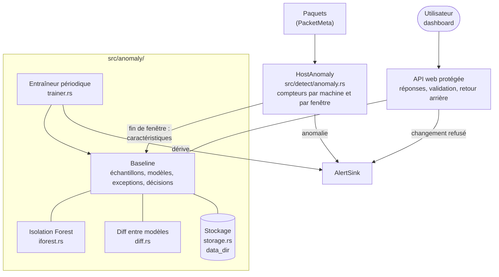
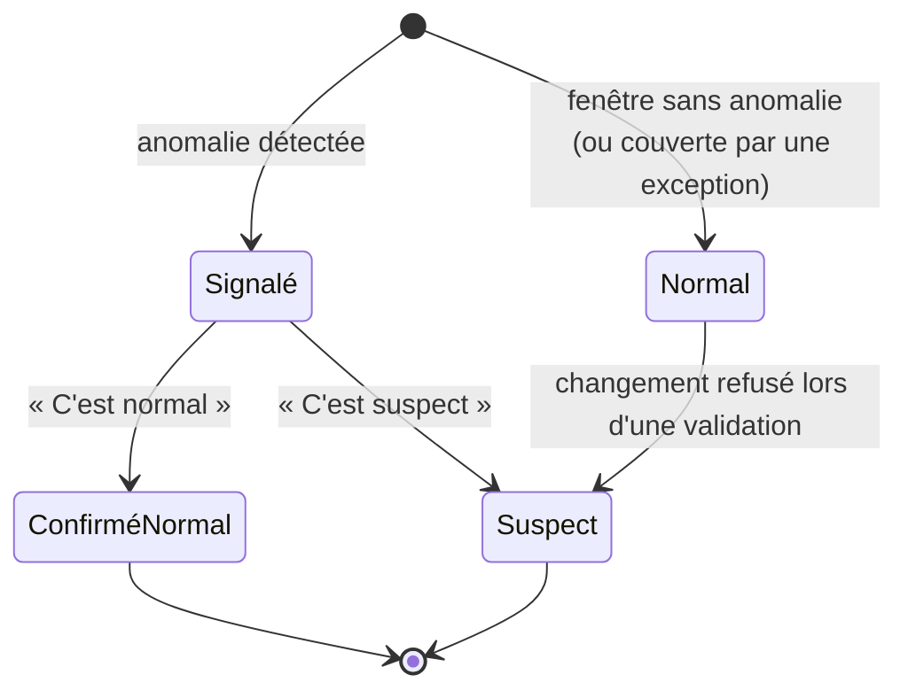
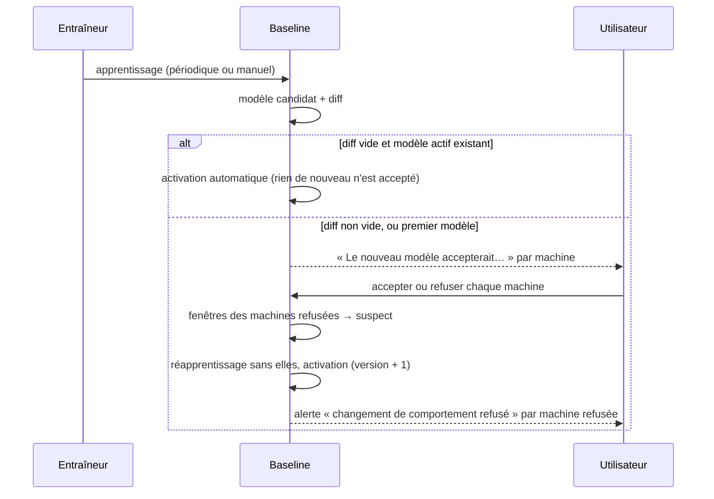

# Conception : apprentissage du comportement normal

| | |
|---|---|
| Statut | Implémenté (voir « Écarts et limites » en fin de document) |
| Date | 11/11/2026 |
| Modules | `src/anomaly/`, `src/detect/anomaly.rs`, `src/web.rs`, `assets/index.html` |

## 1. Contexte

Les détecteurs de Cyward reconnaissent des attaques **connues**, chacune décrite par une règle : scan, force brute, balise C2, tunnel DNS, volume sortant. Ils ne voient pas :

- les **combinaisons inhabituelles** dont chaque mesure, prise seule, reste sous les seuils (une machine qui contacte soudain 40 destinations inconnues, la nuit, sur des ports inhabituels) ;
- les **comportements nouveaux** pour lesquels aucune règle n'existe.

On veut que Cyward **apprenne ce qui est normal sur le réseau** et signale ce qui s'en écarte, sans exemples d'attaques étiquetés.

Le risque principal d'un tel apprentissage est de considérer comme normal ce qui ne l'est pas : une exfiltration régulière, une machine déjà compromise, ou un attaquant qui habitue le modèle par petites étapes. D'où l'exigence centrale de cette conception : **rien n'entre dans le comportement normal sans validation humaine**.

## 2. Décision

1. Un **Isolation Forest** apprend, sans supervision, le profil des machines internes, mesuré par fenêtre de temps.
2. Chaque anomalie est présentée à l'utilisateur avec la question **« est-ce normal ? »**, une liste de motifs (mise à jour, sauvegarde…) et une portée (cette fois, ou désormais).
3. Chaque apprentissage produit un **modèle candidat**. Avant qu'il remplace le modèle actif, Cyward calcule le **diff** entre les deux et demande, machine par machine, si la différence peut entrer dans le comportement normal.
4. La fonctionnalité est **désactivée par défaut**. Une fois activée, elle démarre en **mode observation** : les anomalies apparaissent en sévérité `info`, sans solliciter le LLM, le temps de calibrer le modèle.

### Pourquoi l'Isolation Forest

| Critère | Isolation Forest |
|---|---|
| Données étiquetées nécessaires | Aucune : on n'a jamais d'attaques étiquetées sur son propre réseau |
| Coût d'évaluation | Très faible (quelques centaines de comparaisons par fenêtre) |
| Sensibilité à l'échelle des mesures | Faible : les coupures se font mesure par mesure |
| Mémoire | Quelques Mo pour 100 arbres |
| Explicabilité | Faible : compensée par l'affichage des écarts au profil habituel (section 4.3) |

Alternatives écartées : des seuils statistiques par mesure (ne voient pas les combinaisons), un auto-encodeur (exige un entraînement lourd et une dépendance de calcul), un One-Class SVM (coûteux et sensible au réglage).

L'algorithme est implémenté dans le projet (`src/anomaly/iforest.rs`, environ 150 lignes), sans nouvelle dépendance. Il est donc reproductible : avec la même graine, le même modèle.

## 3. Architecture

| Élément | Rôle | Pattern |
|---|---|---|
| `detect/anomaly.rs` | Agrège le trafic par machine et par fenêtre ; évalue chaque fenêtre | Strategy (nouveau `Detector`) |
| `anomaly/features.rs` | Transforme les compteurs d'une fenêtre en vecteur de caractéristiques (fonction pure) | — |
| `anomaly/iforest.rs` | Isolation Forest : apprentissage et score | — |
| `anomaly/model.rs` | Modèle versionné : forêt, seuil, profils habituels | — |
| `anomaly/diff.rs` | Ce que le candidat accepterait de plus que le modèle actif (fonction pure) | — |
| `anomaly/baseline.rs` | État et règles du cycle de vie (échantillons, candidat, validation, exceptions, retour arrière) | Façade |
| `anomaly/storage.rs` | Lecture et écriture de l'état sur disque | Repository |
| `anomaly/trainer.rs` | Déclenche l'apprentissage au bon moment | — |

Sens des dépendances, conforme aux règles du projet :
- `detect/` dépend de `anomaly` ; `anomaly` ne dépend ni de `detect`, ni de `llm`, ni de `web`.
- `web` (consommateur) dépend de `anomaly` pour l'API de validation.

## 4. Fonctionnement détaillé

### 4.1 Échantillons : une machine, une fenêtre

Toutes les `window_secs` (300 s par défaut), pour chaque machine interne active, on calcule 12 caractéristiques :

| # | Caractéristique | Transformation |
|---|---|---|
| 0 | Octets envoyés | `ln(1 + x)` |
| 1 | Octets reçus | `ln(1 + x)` |
| 2 | Paquets envoyés | `ln(1 + x)` |
| 3 | Connexions TCP ouvertes | `ln(1 + x)` |
| 4 | Destinations distinctes | `ln(1 + x)` |
| 5 | Ports de destination distincts | `ln(1 + x)` |
| 6 | Part des octets envoyés vers l'extérieur | ratio 0 à 1 |
| 7 | Part de destinations jamais vues pour cette machine | ratio 0 à 1 |
| 8 | Requêtes DNS | `ln(1 + x)` |
| 9 | Entropie moyenne des noms DNS demandés | bits par caractère |
| 10 | Heure de la journée (sinus) | `sin(2π·h/24)` |
| 11 | Heure de la journée (cosinus) | `cos(2π·h/24)` |

- La transformation logarithmique empêche les volumes extrêmes d'écraser le reste.
- Le couple sinus/cosinus rend 23 h et 0 h proches.
- Les destinations déjà vues sont mémorisées par machine (2 000 au plus) et persistées.

### 4.2 Statut d'un échantillon

| Statut | Utilisé pour l'apprentissage ? |
|---|---|
| `normal` | Oui, **sauf** si un détecteur à règles a levé une alerte sur cette machine pendant la fenêtre |
| `signalé` (sans réponse) | **Non** |
| `confirmé normal` | Oui |
| `suspect` | **Jamais** |

Les échantillons sont conservés `retention_days` jours (28 par défaut), dans la limite de `max_samples`.

### 4.3 Score et explication

- Le score d'Isolation Forest va de 0 à 1 ; plus il est élevé, plus l'échantillon est facile à isoler, donc inhabituel.
- Le **seuil** n'est pas fixé à la main : c'est le quantile `1 - contamination` des scores des données d'apprentissage (99,5 % par défaut). Chaque modèle porte son propre seuil.
- Pour expliquer une anomalie, on compare chaque caractéristique au **profil habituel** de la machine (médiane et dispersion robuste, ou profil global si la machine a moins de 20 échantillons). Les trois plus gros écarts sont affichés en unités lisibles : « Octets envoyés : 85 Mo (habituellement 1,2 Mo) ».

### 4.4 Question 1 : « est-ce normal ? »

Chaque alerte d'anomalie propose dans le dashboard :

- **C'est normal**, avec un motif (mise à jour d'un jeu ou d'un logiciel, mise à jour système, sauvegarde, nouvel appareil, nouvel usage, autre) et une portée :
  - **cette fois** : les fenêtres concernées passent en `confirmé normal` ;
  - **désormais** : en plus, une **exception** est créée pour cette machine et ce type d'écart (les caractéristiques qui s'écartaient). Une nouvelle anomalie de la même machine dont les principaux écarts sont couverts par l'exception n'est plus signalée. Les exceptions sont effacées à l'activation du modèle suivant, qui a appris ce comportement.
- **C'est suspect** : les fenêtres passent en `suspect` et ne serviront jamais à l'apprentissage.

Une alerte peut couvrir plusieurs fenêtres consécutives (la sauvegarde de deux heures produit une seule alerte) ; la réponse s'applique à toutes.

### 4.5 Question 2 : le diff entre deux apprentissages

Comparer directement deux forêts n'a pas de sens : leurs arbres sont aléatoires. On compare **ce qu'elles acceptent** :

- **Diff de décision** : parmi les données d'apprentissage du candidat, les fenêtres que le **modèle actif signalait** et que le **candidat trouve normales**. C'est exactement ce que l'apprentissage s'apprête à accepter.
- **Diff de profil** : par machine, les caractéristiques dont le 95e centile change de plus de 50 % (en unités naturelles).
- **Dérive cumulée** : par machine, les volumes (octets, connexions, destinations) dont la médiane a été multipliée ou divisée par plus de `drift_factor` (10 par défaut) depuis le **premier** modèle validé. Elle bloque l'empoisonnement par petits pas, que chaque diff pris isolément laisserait passer.

Le diff est présenté **par machine**. L'utilisateur accepte ou refuse chacune :

- **Sans réponse**, le modèle actif reste en place : **rien n'est accepté par défaut**, et aucun nouvel apprentissage n'est lancé tant qu'un candidat attend.
- **Premier modèle** : il n'y a pas de modèle actif à comparer. Le diff présente le profil appris de chaque machine, qui doit être validé.
- **Dérive** : un candidat qui présente une dérive cumulée lève une alerte `baseline_drift` (haute).

### 4.6 Versions et retour arrière

Chaque modèle validé est enregistré (`models/v<N>.json`). Les `max_versions` derniers (10) sont conservés, et l'API permet de revenir à l'un d'eux.

### 4.7 Journal des décisions

Chaque réponse, validation, activation automatique ou retour arrière est ajoutée à `decisions.jsonl` : date, type, machine, détail, motif. Les 100 dernières entrées sont aussi affichées dans le dashboard.

### 4.8 Persistance et cohabitation avec la détection

Deux contraintes d'exploitation, mesurées sur 200 000 fenêtres (le plafond `max_samples`) :

- **Pas de calcul long sous verrou.** Un apprentissage prend environ 1,25 s sur un PC, plusieurs secondes sur un Raspberry Pi. Le moteur de détection prend le verrou de l'état à chaque fin de fenêtre : s'il attendait la fin du calcul, la file de capture (65 536 paquets) pourrait déborder. L'apprentissage se fait donc en trois temps : copie des fenêtres utiles sous verrou, calcul du modèle et du diff hors verrou, publication sous verrou. Pendant le calcul, un second apprentissage, une validation et un retour arrière sont refusés, pour que le résultat ne soit pas déjà périmé à sa publication. La validation qui réentraîne (machines refusées) suit le même schéma.
- **Pas de réécriture complète à chaque sauvegarde.** L'état complet en JSON pèse environ 62 Mo : le réécrire toutes les 10 minutes représenterait environ 9 Go par jour, de quoi user une carte SD. Les échantillons vont donc dans un journal en ajout seul, `samples.jsonl`, avec une ligne par fenêtre ajoutée ou par changement de statut. Le journal est réécrit (compaction) quand il dépasse deux fois le nombre d'échantillons conservés, plus 10 000 lignes de marge. `state.json` ne contient plus que le reste de l'état, et n'est réécrit que s'il a changé. Les écritures se font hors verrou, dans un thread dédié.

Au chargement, le journal est rejoué dans l'ordre, puis la rétention est appliquée. Une dernière ligne coupée par un arrêt brutal est ignorée. Un `state.json` de l'ancien format (échantillons inclus) est repris, puis migré à la première sauvegarde.

## 5. Garde-fous (récapitulatif)

| Risque | Garde-fou |
|---|---|
| Apprendre une attaque comme normale | Validation humaine de chaque nouveau modèle ; fenêtres signalées exclues tant qu'elles sont sans réponse |
| Apprendre pendant une attaque détectée par ailleurs | Fenêtres d'une machine visée par une alerte à règles exclues de l'apprentissage |
| Empoisonnement par petits pas | Dérive cumulée mesurée depuis le premier modèle validé, avec alerte |
| Validation par erreur | Versions conservées, retour arrière |
| Décision automatique trompée | Le LLM peut **suggérer** un motif, jamais valider ; une exception ne fait jamais taire un détecteur à règles |
| Validation à la place de l'utilisateur (page piégée, CSRF) | API d'écriture refusée si `web.token` est vide ; jeton exigé dans l'en-tête `Authorization`, jamais dans l'URL |
| Absence de traçabilité | Journal des décisions sur disque |
| Fausse alerte en début d'usage | Mode observation par défaut : sévérité `info`, pas de LLM |

## 6. Interfaces

### Configuration `[detection.anomaly]`

| Clé | Défaut | Rôle |
|---|---|---|
| `enabled` | `false` | Active l'apprentissage |
| `mode` | `"observation"` | `observation` (alertes `info`) ou `alert` (alertes `medium`, analysées par le LLM) |
| `window_secs` | `300` | Durée d'une fenêtre |
| `data_dir` | `""` | Dossier de persistance ; vide = en mémoire seulement (perdu au redémarrage) |
| `min_training_samples` | `500` | Échantillons utilisables nécessaires pour apprendre |
| `learning_hours` | `168` | Durée d'observation avant le premier apprentissage automatique |
| `retrain_interval_hours` | `168` | Délai entre deux apprentissages automatiques |
| `retention_days` | `28` | Durée de conservation des échantillons |
| `max_samples` | `200000` | Plafond du nombre d'échantillons |
| `trees` / `sample_size` | `100` / `256` | Paramètres de l'Isolation Forest |
| `contamination` | `0.005` | Part des données d'apprentissage considérée comme atypique (fixe le seuil) |
| `drift_factor` | `10` | Facteur de dérive cumulée qui déclenche une alerte |
| `max_versions` | `10` | Versions de modèle conservées |

### API (écriture protégée : jeton obligatoire, dans l'en-tête)

| Route | Rôle |
|---|---|
| `GET /api/baseline` | État : mode, échantillons par statut, modèle actif, candidat et son diff, versions, exceptions, décisions récentes |
| `POST /api/baseline/train` | Lance un apprentissage maintenant (sans attendre `learning_hours`) |
| `POST /api/baseline/decision` | `{"accepted": ["192.168.1.20"], "rejected": ["192.168.1.35"]}` : chaque machine du diff doit figurer dans l'une des listes |
| `POST /api/baseline/rollback` | `{"version": 3}` |
| `POST /api/alerts/{id}/feedback` | `{"verdict": "normal" \| "suspect", "reason": "sauvegarde", "scope": "once" \| "always"}` |

### Types d'alerte ajoutés

| `kind` | Sévérité | Quand |
|---|---|---|
| `host_anomaly` | `info` (observation) ou `medium` (alerte) | Fenêtre jugée anormale par le modèle actif |
| `baseline_drift` | `high` | Un candidat présente une dérive cumulée |
| `baseline_rejected` | `high` | L'utilisateur a refusé le nouveau comportement d'une machine |

## 7. Tests

- Isolation Forest : un point isolé obtient un score plus élevé que les points d'un nuage ; même graine, même modèle ; sérialisation sans perte ; données constantes sans erreur.
- Caractéristiques : transformations et encodage de l'heure.
- Cycle de vie complet, sans réseau : apprentissage initial soumis à validation, activation, anomalie signalée, réponse « normal / désormais » qui crée une exception, réponse « suspect » qui exclut, diff qui liste la machine dont le comportement change, refus qui exclut ses fenêtres, dérive détectée, retour arrière, fenêtres touchées par une alerte à règles exclues.
- Persistance : sauvegarde puis rechargement d'un état complet ; sauvegarde incrémentale (seules les nouveautés sont ajoutées, rien n'est écrit sans changement) ; compaction ; reprise de l'ancien format ; ligne de journal coupée ignorée.
- Calcul en cours : second apprentissage, validation et retour arrière refusés, enregistrement des fenêtres toujours possible.
- Contrôle d'accès de l'API d'écriture.
- Test de bout en bout : rejeu du pcap d'attaques, apprentissage manuel et validation par l'API, puis second rejeu avec le modèle chargé depuis le disque.

## 8. Écarts et limites

### Ajustements décidés pendant l'implémentation

Trois problèmes sont apparus lors des tests. Leur correction fait partie de la conception :

1. **Masquage des valeurs extrêmes.** Dans l'algorithme d'origine, un point très au-delà des données d'apprentissage (100 fois plus d'octets que d'habitude) suit, à chaque coupure, le même chemin que les points extrêmes, et reste mélangé à eux. Il n'est donc pas isolé vite, alors que c'est le cas le plus important. **Correctif** : chaque coupure mémorise la plage des valeurs vues à ce nœud ; une valeur hors de cette plage est considérée comme isolée immédiatement.
2. **Bruit du diff.** Deux forêts entraînées sur les mêmes données ne placent pas exactement les mêmes fenêtres au-dessus de leur seuil (environ `contamination` chacune). Sans précaution, le diff n'était jamais vide et la question aurait été posée à chaque apprentissage. **Correctif** : les fenêtres nouvellement acceptées d'une machine ne sont retenues que si elles dépassent ce bruit attendu (2 × `contamination` de ses fenêtres, au moins 3). Les changements de profil et la dérive restent toujours signalés.
3. **Référence des explications.** Une machine qui a moins de 20 fenêtres apprises est comparée au profil de tout le réseau. Le test de bout en bout affichait alors « habituellement 0.0 o » pour une machine dont ce n'était pas l'habitude. **Correctif** : l'explication précise « médiane du réseau, machine encore peu connue ».

Côté interface, un premier modèle sur un réseau réel liste de nombreuses machines vues une ou deux fois (40 dans le test de bout en bout, dont 37 touchées par un seul balayage). Le dashboard propose donc « Tout accepter » et « Tout refuser », et replie les machines peu actives (3 fenêtres au plus, sans changement de profil). La règle reste inchangée : chaque machine reçoit une décision.

### Test de bout en bout réalisé

Pcap d'attaques simulées (`examples/gen_attacks.rs`), fenêtres de 60 s, LLM réel (Foundation-Sec-8B via Ollama) :

1. Premier rejeu : 150 fenêtres enregistrées. Le poste compromis `192.168.1.20` n'a que 17 fenêtres sur 40 proposées à l'apprentissage : les autres chevauchent les alertes à règles (scan, C2, tunnel DNS, exfiltration).
2. Apprentissage par l'API : refusé avec le jeton en paramètre d'URL, accepté avec l'en-tête. Premier modèle en attente de validation, validé depuis le dashboard (« Tout accepter », « Valider ma décision ») : modèle v1 actif, persisté, 40 décisions au journal.
3. Second rejeu après redémarrage : v1 rechargé depuis le disque, 2 anomalies sur `192.168.1.20` (scan et tunnel DNS fusionnés sur 5 fenêtres, puis exfiltration), aucune sur le portable ni sur le résolveur.
4. Le LLM a analysé l'anomalie (verdict « suspect », 0,79) en proposant une hypothèse bénigne à confirmer par l'utilisateur, conformément à la consigne. Elle était fausse, ce qui illustre l'intérêt de la validation humaine.
5. Réponse « C'est suspect » depuis le dashboard : 5 fenêtres marquées suspectes.

### Limites

- Le **candidat n'est pas persisté** : après un redémarrage, il faut relancer l'apprentissage. Le modèle actif, les échantillons, les exceptions et le journal le sont.
- Le LLM **suggère** un motif dans son analyse des anomalies (mode `alert`), mais ne propose pas encore de motif dans l'écran de diff.
- L'agent n'apprend que le trafic qu'il voit : sans port miroir, il ne connaît que la machine qui l'héberge.
- Sur un petit réseau aux usages irréguliers, le mode observation est indispensable pendant les premières semaines.
