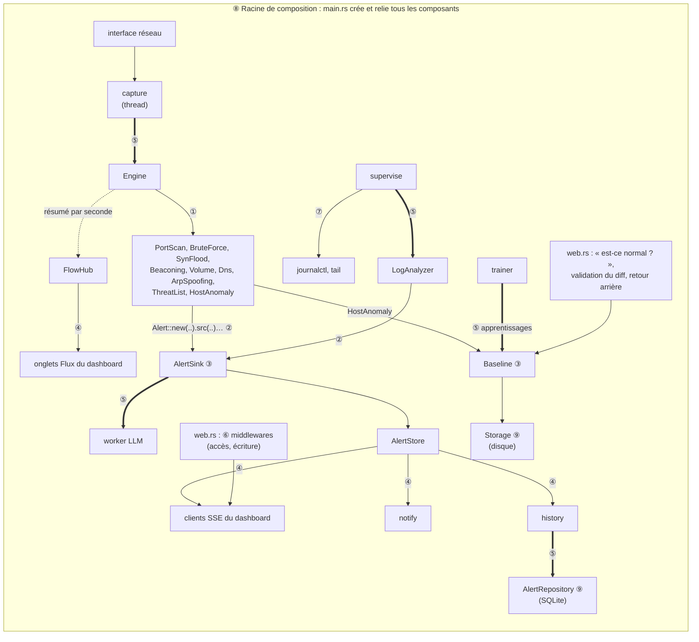

# Architecture du code

```
cyward/
├── Cargo.toml
├── rustfmt.toml               # règles de formatage du code (cargo fmt)
├── config.example.toml        # configuration commentée, toutes valeurs par défaut
├── Dockerfile, compose.yaml   # image et déploiement Docker
├── docker/cyward.toml         # configuration utilisée par l'image Docker
├── LICENSE                    # Apache 2.0
├── CLAUDE.md                  # règles du projet pour Claude Code
├── README.md                  # présentation, fonctionnalités, démarrage Docker, licence
├── docs/                      # documentation détaillée (index : docs/README.md)
│   ├── fonctionnement.md, architecture.md, detecteurs.md, llm.md
│   ├── installation.md, utilisation.md, configuration.md, dashboard-api.md
│   ├── deploiement.md, tests.md, exploitation.md, securite.md, limites.md
│   └── conception-normalite.md  # conception de l'apprentissage du comportement normal
├── .claude/skills/            # skills : verifier, nouveau-detecteur, nouvelle-regle-log, revue
├── assets/
│   ├── index.html             # dashboard (embarqué dans le binaire à la compilation)
│   └── logo.svg, logo.png (512 px), logo-wordmark.svg, favicon.svg
├── examples/
│   ├── gen_attacks.rs         # générateur de pcap d'attaques simulées
│   ├── rejeu.toml             # configuration du rejeu (liste de menaces, passerelle)
│   └── menaces.txt            # liste de menaces d'exemple (adresses de documentation)
└── src/
    ├── main.rs                # CLI, assemblage des tâches, boucle du moteur   ⑤ ⑧
    ├── banner.rs              # bannière de démarrage (logo, version, résumé de la config)
    ├── config.rs              # structures de configuration (TOML + valeurs par défaut)
    ├── alert.rs               # modèle d'alerte (types, gravité, constructeur)  ②
    ├── alert/
    │   ├── store.rs           # AlertStore : dédoublonnage, diffusion           ④
    │   └── sink.rs            # AlertSink : point d'entrée unique des alertes   ③
    ├── stats.rs               # compteurs exposés au dashboard
    ├── flows.rs               # résumé du trafic par seconde (onglet Flux)       ④
    ├── capture.rs             # capture live, rejeu pcap, parsing des paquets  ⑤
    ├── detect.rs              # trait Detector et moteur                       ①
    ├── detect/
    │   ├── scan.rs            # scan, balayage, force brute, inondation SYN    ①
    │   ├── beacon.rs          # balises périodiques (C2)                       ①
    │   ├── volume.rs          # volume sortant anormal (exfiltration)          ①
    │   ├── dns.rs             # DNS à forte entropie, tunnel DNS               ①
    │   ├── threat.rs          # trafic avec des IP de listes de menaces        ①
    │   ├── arp.rs             # usurpation ARP (homme du milieu)               ①
    │   └── anomaly.rs         # écarts au comportement normal appris           ①
    ├── anomaly.rs             # apprentissage du comportement normal (racine du module)
    ├── anomaly/
    │   ├── features.rs        # 12 caractéristiques par machine et par fenêtre
    │   ├── iforest.rs         # Isolation Forest (sans dépendance)
    │   ├── model.rs           # échantillons et modèles versionnés
    │   ├── diff.rs            # ce qu'un nouveau modèle accepterait de plus
    │   ├── baseline.rs        # cycle de vie et garde-fous de validation        ③
    │   ├── baseline/
    │   │   ├── samples.rs     # journal des échantillons, rétention, compaction
    │   │   └── status.rs      # état renvoyé au dashboard (GET /api/baseline)
    │   ├── storage.rs         # persistance sur disque                          ⑨
    │   └── trainer.rs         # apprentissages périodiques                      ⑤
    ├── logs.rs                # sources de logs (journalctl, tail -F)          ⑤ ⑦
    ├── logs/
    │   └── rules.rs           # trait LogRule et règles d'analyse              ①
    ├── llm.rs                 # client du modèle, prompt, décodage du verdict  ⑤
    ├── names.rs               # noms des machines (DNS inverse, avec cache)
    ├── history.rs             # historique des alertes : regroupement, rétention ④ ⑤
    ├── history/
    │   └── repository.rs      # base SQLite des alertes                        ⑨
    ├── notify.rs              # notifications : décision, plafond, envoi        ④ ⑤
    ├── notify/
    │   └── channels.rs        # trait Notifier : ntfy, webhook générique       ①
    └── web.rs                 # serveur HTTP, API JSON, flux SSE               ④ ⑥
```

Les numéros en fin de ligne renvoient aux [design patterns](#design-patterns-utilisés) mis en œuvre dans le fichier.

Un module à sous-fichiers suit la forme recommandée par Rust depuis l'édition 2018 : sa racine est `nom.rs`, ses sous-modules sont dans `nom/` (par exemple `detect.rs` et `detect/scan.rs`). Aucun fichier ne s'appelle `mod.rs`.

## Les composants

**`main.rs`** — racine de composition ⑧, consommateur du pipeline ⑤
- Lit la ligne de commande et la configuration, crée les composants et les relie (canaux, `Arc` partagés).
- `run_engine` consomme les paquets et transmet les alertes produites à l'`AlertSink`.

**`capture.rs`** — producteur du pipeline ⑤
- **Capture live** : utilise `pnet_datalink`, qui ouvre une socket `AF_PACKET`. Cette crate est en pur Rust, sans dépendance à libpcap. La lecture tourne dans un thread dédié et envoie des `PacketMeta` au moteur par un canal borné (`capture.queue_size`). Si le moteur ne suit pas, les paquets sont abandonnés plutôt que de bloquer la capture, et le compteur « Perdus » augmente.
- **Rejeu** : lit un fichier pcap classique avec `pcap-file`. Les types de lien gérés sont Ethernet, Linux SLL (`tcpdump -i any`) et IP brut.
- **Parsing** : assuré par `etherparse` ; la question DNS est extraite à la main. Les trames ARP (IPv4 sur Ethernet) donnent aussi un `PacketMeta` (`proto = Arp`), avec l'IP et la MAC annoncées dans `arp`, pour le détecteur d'usurpation ARP ; les autres détecteurs les ignorent.

**`detect/`** — Strategy ①
- Neuf stratégies : huit détecteurs à règles, plus `HostAnomaly` qui alimente l'apprentissage du comportement normal (s'il est activé). `ThreatList` n'est créé que si une liste de menaces est configurée.
- Chaque détecteur implémente :
  ```rust
  trait Detector {
      fn on_packet(&mut self, p: &PacketMeta, out: &mut Vec<Alert>);
      fn tick(&mut self, now: f64, out: &mut Vec<Alert>);   // ~1 fois par seconde
  }
  ```
- Les détecteurs raisonnent sur **l'horodatage des paquets**, pas sur l'horloge murale. Le rejeu d'un pcap donne donc exactement les mêmes résultats que la capture d'origine.
- `tick` sert à clore des fenêtres de temps et à purger l'état ancien, ce qui borne la mémoire.
- Les IP de la `whitelist` sont ignorées en tant que source.

**`logs.rs`** — producteur/consommateur ⑤, superviseur ⑦
- Lance `journalctl -f -o json` et/ou `tail -F` sur les fichiers configurés, et relance la commande si elle s'arrête.
- Les lignes, décodées en `LogLine`, passent au `LogAnalyzer` (`logs/rules.rs`, Strategy ①).
- Chaque règle implémente `trait LogRule { fn check(&mut self, line: &LogLine, out: &mut Vec<Alert>); }` et garde son propre état. Par exemple, `SshAuth` mémorise par IP l'historique des échecs d'authentification.
- Une règle à une seule regex et sans état est un `Pattern` : la regex, plus la fonction qui construit l'alerte.

**`alert.rs`, `alert/store.rs`, `alert/sink.rs`** — Builder ② (`Alert`), Observer ④ (`AlertStore`), Façade ③ (`AlertSink`)
- **`alert.rs`** porte le modèle de données : `Alert` et son constructeur, `Severity`, `AlertKind`, le triage et la réponse de l'utilisateur. Il réexporte `AlertStore`, `AlertEvent` et `AlertSink` : le reste du code les importe depuis `crate::alert`, sans connaître le découpage.
- **`AlertSink`** (`alert/sink.rs`) est le point d'entrée unique des détecteurs. Il enregistre l'alerte et l'envoie en triage IA si sa sévérité le justifie.
- **`AlertStore`** (`alert/store.rs`) garde les 5 000 dernières alertes en mémoire. Si l'historique est activé (`[history]`), il les recharge au démarrage (`restore`).
- Il **dédoublonne** les alertes selon une empreinte (type + source + cible). Une alerte identique pendant `alert_cooldown_secs` incrémente le compteur `count` de l'alerte existante au lieu d'en créer une nouvelle.
- Chaque création ou mise à jour est diffusée aux navigateurs connectés.

**`llm.rs`** — consommateur du pipeline ⑤
- Une tâche de fond vérifie toutes les 30 s que le serveur répond et que le modèle est installé.
- Une autre tâche consomme la file de triage, une alerte à la fois.

**`web.rs`** — observateur ④ (flux SSE), Middleware ⑥
- Serveur `axum`. Il sert le dashboard, une API JSON et deux flux Server-Sent Events : les alertes (`/api/events`) et le trafic résumé de l'onglet Flux (`/api/flows`).

**`flows.rs`** — sujet ④ (`FlowHub`)
- `FlowMeter` additionne paquets et octets par couple (source, destination, nature : TCP, UDP, DNS, ICMP, ARP) pendant une seconde de temps des paquets, puis produit un résumé limité aux 50 couples les plus lourds ; le reste est additionné dans « autres ». Logique pure, testée sans réseau.
- `run_engine` (`main.rs`) l'alimente et publie les résumés par `FlowHub`, un canal `broadcast` comme celui des alertes, auquel s'abonne chaque onglet Flux ouvert.
- **Aucun coût quand personne ne regarde** : le moteur ne compte rien tant qu'aucun onglet n'est abonné (vérifié une fois par seconde). Vue ouverte, le comptage coûte environ 45 ns par paquet, soit environ 0,5 % d'un cœur à 100 000 paquets/s.
- **Mémoire bornée** : 10 000 couples par seconde au plus ; au-delà, les paquets vont directement dans « autres » (adresses usurpées).

**`notify.rs`** — observateur ④, producteur/consommateur ⑤ ; `notify/channels.rs` — Strategy ①
- Envoie une notification (ntfy, webhook générique) pour les attaques jugées malveillantes ou suspectes par l'IA, pour les alertes critiques sans attendre l'IA, et en repli pour les alertes graves restées sans verdict. Une alerte n'est notifiée qu'une fois, avec un plafond horaire.
- S'abonne aux événements de l'`AlertStore`, comme le dashboard : ni les détecteurs ni le LLM ne le connaissent.
- La décision (`Dispatcher`) est pure et testée sans réseau ; l'envoi tourne dans une autre tâche, derrière une file bornée, avec trois essais. Chaque canal implémente `trait Notifier`, qui construit la requête HTTP propre au service.
- Détails : [`[notify]`](configuration.md#notify).

**`history.rs`** — observateur ④, producteur/consommateur ⑤ ; `history/repository.rs` — Repository ⑨
- Garde les alertes dans une base **SQLite** (`history.path`) : elles survivent au redémarrage, triage du LLM et réponses comprises. Au démarrage, les 5 000 plus récentes sont rechargées dans l'`AlertStore` et les identifiants reprennent où ils s'étaient arrêtés.
- S'abonne aux événements de l'`AlertStore`, comme le dashboard et les notifications. Les écritures passent par un thread dédié derrière une file bornée : la détection n'attend jamais le disque.
- Une alerte modifiée plusieurs fois (répétitions, verdict du LLM) n'est écrite qu'une fois par lot, toutes les 5 s, en une transaction.
- **Protection contre une inondation** : purge par âge (`retention_days`) et par nombre (`max_alerts`) toutes les heures, et dès que `max_alerts / 10` alertes nouvelles ont été écrites. Les preuves d'une alerte sont plafonnées à 4 Ko. Détails : [`[history]`](configuration.md#history).
- La décision (regroupement `Batcher`, politique `Retention`) est pure et testée sans disque ; `AlertRepository` est seul à connaître SQLite.

**`names.rs`**
- Donne le nom des machines (DNS inverse, enregistrement PTR) affiché à côté des adresses dans le dashboard, via `GET /api/names`. Rien n'est résolu sur le chemin de la détection, et les alertes ne changent pas.
- Construction de la requête et lecture de la réponse DNS sont des fonctions pures (testées sans réseau, réponses piégées comprises) ; seul l'échange UDP avec le serveur fait des I/O.
- Cache borné (4 096 adresses), absences de nom comprises. Par défaut, seules les adresses internes sont résolues (voir `[names]`).

**`anomaly/`** — Façade ③ (`Baseline`), Repository ⑨ (`Storage`)
- Apprend le comportement normal de chaque machine interne avec un **Isolation Forest**, et ne fait rien entrer dans ce comportement sans validation humaine. Conception complète : [docs/conception-normalite.md](conception-normalite.md).
- `detect/anomaly.rs` (une stratégie ① de plus) résume le trafic de chaque machine par fenêtre ; `Baseline` enregistre ces échantillons, les fait juger par le modèle actif, gère le modèle candidat, son diff, les exceptions, les versions et le journal des décisions.
- Désactivé par défaut (`[detection.anomaly]`), voir [Apprentissage du comportement normal](detecteurs.md#apprentissage-du-comportement-normal-hostanomaly).

**`banner.rs`**
- Construit la bannière affichée au démarrage. La fonction de rendu est pure (elle renvoie une chaîne) ; seul `main.rs` l'affiche, avec ou sans couleurs selon le terminal.

## Dépendances entre modules

Les dépendances vont dans un seul sens : les **producteurs** d'alertes (`detect/`, `logs.rs`) ne connaissent pas les **consommateurs** (`llm.rs`, `web.rs`), et inversement. Tous se rejoignent sur le module `alert` (`alert.rs` et `alert/`).

| Module | Dépend de | Ne doit jamais dépendre de |
|---|---|---|
| `detect/` | `alert`, `anomaly`, `capture` (`PacketMeta`), `config` | `llm`, `web`, `logs` |
| `anomaly/` | `alert`, `config` | `detect`, `llm`, `web`, `logs` |
| `logs.rs` | `alert`, `config`, `stats` | `llm`, `web`, `detect` |
| `llm.rs` | `alert`, `config`, `stats` | `detect`, `logs`, `web` |
| `web.rs` | `alert`, `anomaly`, `flows`, `names`, `stats` | `detect`, `logs`, `llm` |
| `flows.rs` | `capture` (`PacketMeta`) | `detect`, `logs`, `llm`, `web` |
| `names.rs` | `alert` (`host_part`), `config` | `detect`, `logs`, `llm`, `web` |
| `notify.rs` (et `notify/channels.rs`) | `alert`, `config` | `detect`, `logs`, `llm`, `web` |
| `history.rs` (et `history/repository.rs`) | `alert`, `config` | `detect`, `logs`, `llm`, `web` |
| `main.rs` | tous | — |

`main.rs` est la **racine de composition** : c'est le seul endroit qui crée les composants et les relie entre eux (canaux, `Arc` partagés). Changer de serveur LLM, ou désactiver le triage IA, ne demande donc aucune modification des détecteurs.

Autre principe de découpage : **la logique de décision ne fait pas d'entrées/sorties**. `parse_packet`, `parse_dns_query`, les détecteurs (seul `Blocklist::load` lit les listes de menaces, une fois, à la création du moteur), `LogAnalyzer::analyze`, `parse_analysis`, `banner::render`, la lecture des réponses DNS de `names.rs`, les caractéristiques, l'Isolation Forest et le diff de `anomaly/`, ainsi que le regroupement et la rétention de `history.rs`, le résumé du trafic de `flows.rs`, ne touchent ni au réseau, ni aux fichiers, ni au LLM. Ils se testent avec de simples valeurs en mémoire, et les I/O restent en bordure (sockets, sous-processus, HTTP).

## Design patterns utilisés

Cyward est construit sur **9 design patterns**. Le schéma montre où chacun intervient dans le parcours d'une donnée, du paquet ou de la ligne de log jusqu'au navigateur et au LLM. Chaque pattern est ensuite détaillé avec ses rôles, le vrai code et la façon de s'en servir.



① Strategy · ② Builder · ③ Façade · ④ Observer · ⑤ Producteur/consommateur (flèche épaisse = canal) · ⑥ Middleware · ⑦ Superviseur · ⑧ Racine de composition · ⑨ Repository

| # | Pattern | Où | Problème résolu dans Cyward |
|---|---|---|---|
| ① | **Strategy** | `trait Detector`, `Engine` (`src/detect/`) ; `trait LogRule`, `LogAnalyzer` (`src/logs/rules.rs`) ; `trait Notifier` (`src/notify/channels.rs`) | Ajouter une détection réseau (y compris l'apprentissage du comportement normal), une règle de log ou un canal de notification sans toucher au code existant |
| ② | **Builder** | `Alert::new(...).src(...)...` (`src/alert.rs`) | Construire lisiblement une alerte aux nombreux champs optionnels |
| ③ | **Façade** | `AlertSink::emit` (`src/alert/sink.rs`) ; `Baseline` (`src/anomaly/baseline.rs`) | Un point d'entrée unique qui masque un sous-système : stockage et triage des alertes ; cycle de vie du comportement normal |
| ④ | **Observer** | `AlertStore` + canal `broadcast` → SSE (`src/alert/store.rs`, `src/web.rs`), notifications (`src/notify.rs`), historique (`src/history.rs`) ; `FlowHub` → onglets Flux (`src/flows.rs`) | Prévenir un nombre inconnu de navigateurs, le service de notifications et l'historique sur disque à chaque changement ; diffuser le trafic résumé aux onglets ouverts, et savoir quand il n'y en a aucun pour ne rien compter |
| ⑤ | **Producteur/consommateur** | canaux `mpsc` (`main.rs`, `capture.rs`, `logs.rs`, `llm.rs`, `notify.rs`, `history.rs`) | Découpler des étages de vitesses très différentes |
| ⑥ | **Middleware** | `auth`, `write_guard` (`src/web.rs`) | Appliquer le contrôle d'accès à toutes les routes, et un contrôle renforcé aux routes d'écriture, en un seul endroit |
| ⑦ | **Superviseur** | `logs::supervise` (`src/logs.rs`) | Relancer une source de logs qui s'arrête |
| ⑧ | **Racine de composition** | `start_pipeline`, `run` (`src/main.rs`) | Injecter les dépendances au lieu d'un état global |
| ⑨ | **Repository** | `Storage` (`src/anomaly/storage.rs`) ; `AlertRepository` (`src/history/repository.rs`) | Isoler la persistance : le reste du code manipule des structures, sans savoir où ni comment elles sont écrites (fichiers JSON de l'apprentissage, base SQLite des alertes) |

### ① Strategy : les détecteurs

**Principe** : une famille d'algorithmes interchangeables derrière une interface commune. Le code qui les utilise ne connaît que l'interface.

**Rôles dans Cyward :**
- **Interface de stratégie** : le trait `Detector`.
- **Stratégies concrètes** : `PortScan`, `BruteForce`, `SynFlood` (`scan.rs`), `Beaconing` (`beacon.rs`), `Volume` (`volume.rs`), `Dns` (`dns.rs`), `ArpSpoofing` (`arp.rs`), `ThreatList` (`threat.rs`), ajoutée seulement si une liste de menaces est configurée, et `HostAnomaly` (`anomaly.rs`), ajoutée seulement si l'apprentissage est activé.
- **Contexte** : `Engine`, qui détient les stratégies sous forme de `Box<dyn Detector>` et leur distribue chaque paquet sans savoir ce qu'elles font.

```rust
// src/detect.rs — l'interface commune
pub trait Detector: Send {
    fn on_packet(&mut self, p: &PacketMeta, out: &mut Vec<Alert>);
    fn tick(&mut self, _now: f64, _out: &mut Vec<Alert>) {}
}

// Le contexte ne manipule que le trait…
pub struct Engine {
    detectors: Vec<Box<dyn Detector>>,
    // …
}

// …et appelle chaque stratégie de la même façon.
for d in &mut self.detectors {
    d.on_packet(p, &mut out);
}
```

**Utilisation** : un nouveau détecteur est une nouvelle structure qui implémente `Detector`, ajoutée à la liste de `Engine::new`. Ni le moteur ni les autres détecteurs ne sont modifiés (principe ouvert/fermé). Le skill `/nouveau-detecteur` décrit la démarche complète.

**Même pattern pour les logs** : le trait `LogRule` (`src/logs/rules.rs`) joue le rôle de `Detector`, et `LogAnalyzer` celui d'`Engine`.
- Les stratégies concrètes sont `SshAuth` (échecs et succès SSH, avec état par IP), `Sudo`, une règle `Custom` par règle de la configuration, et des `Pattern` pour les règles à une seule regex (su, création de compte, groupe privilégié, noyau).
- Une nouvelle règle s'ajoute à la liste de `LogAnalyzer::new`, sans toucher aux autres. Le skill `/nouvelle-regle-log` décrit la démarche.

### ② Builder : la construction des alertes

**Principe** : construire un objet complexe étape par étape, en ne renseignant que les parties utiles.

**Rôles dans Cyward :**
- **Construction de base** : `Alert::new(kind, severity, source, date, titre)`, qui reçoit les champs obligatoires.
- **Étapes facultatives** : `.description()`, `.src()`, `.dst()`, `.evidence()`, `.fingerprint()`. Chacune prend l'alerte et la renvoie complétée, ce qui permet de les chaîner.

```rust
// src/detect/scan.rs — chaque détecteur ne renseigne que ce qui le concerne
Alert::new(AlertKind::BruteForce, Severity::High, AlertSource::Network, ts_to_dt(p.ts), format!("Force brute probable sur {}:{} depuis {}", p.dst, p.dport, p.src))
    .description(format!("{} connexions TCP vers le port {} ({}) en moins de {} s.", /* … */))
    .src(p.src)
    .dst(format!("{}:{}", p.dst, p.dport))
    .evidence(json!({ "connections": count, "port": p.dport, "service": service_name(p.dport) }))
```

C'est la forme idiomatique du Builder en Rust : pas de structure `AlertBuilder` séparée, puisque l'alerte est valide à chaque étape.

**Utilisation** : un nouveau champ optionnel d'alerte s'ajoute avec sa méthode chaînable dans `impl Alert`, sans changer la signature de `Alert::new` ni les appels existants.

### ③ Façade : le point d'entrée des alertes

**Principe** : une interface simple devant un ensemble de sous-systèmes.

**Rôles dans Cyward :**
- **Façade** : `AlertSink`, et sa seule méthode `emit(alert)`.
- **Sous-systèmes masqués** : l'`AlertStore` (enregistrement, dédoublonnage), la file d'analyse du LLM et le suivi du statut de triage.
- **Clients** : le moteur de détection (`run_engine`) et l'analyse des logs (`logs::run`).

```rust
// src/alert/sink.rs
pub fn emit(&self, alert: Alert) {
    // Enregistrement et dédoublonnage : une répétition fusionnée s'arrête là.
    let Some(new) = self.store.push(alert) else { return };
    if let Some(tx) = &self.triage
        && new.severity >= self.min_severity
    {
        self.store.update(new.id, |a| a.triage = TriageStatus::Pending);
        if tx.try_send(new.id).is_err() { /* file pleine : pas d'analyse */ }
    }
}
```

**Seconde façade : `Baseline`** (`src/anomaly/baseline.rs`). Le détecteur, l'entraîneur et l'API web n'appellent que ses méthodes (`record_window`, `feedback`, `train`, `decide`, `rollback`, `status`). Elle masque les échantillons, le modèle actif et le candidat, le diff, les exceptions, les versions, le journal et le stockage, et c'est elle qui applique tous les garde-fous de validation : aucun appelant ne peut les contourner.

**Utilisation** : tout nouveau producteur d'alertes reçoit un `AlertSink` et appelle `emit`. Il ne doit jamais écrire directement dans le store ni dans la file du LLM. Une règle transverse (par exemple notifier un webhook) s'ajoute ici, une seule fois, pour toutes les sources.

### ④ Observer : la diffusion en direct au dashboard

**Principe** : un sujet prévient automatiquement tous ses observateurs quand son état change, sans les connaître.

**Rôles dans Cyward :**
- **Sujet** : `AlertStore`, qui possède l'émetteur `events: broadcast::Sender<AlertEvent>`.
- **Événements** : `AlertEvent::New` et `AlertEvent::Update`.
- **Observateurs** : chaque connexion SSE d'un navigateur, la tâche des notifications (`notify::watch`) et celle de l'historique (`history::watch`). Chacun s'abonne avec `subscribe()` et reçoit une copie de chaque événement.
- **Second sujet** : `FlowHub` (`src/flows.rs`), qui diffuse le trafic résumé par seconde aux onglets Flux. Le moteur interroge aussi son nombre d'abonnés : sans observateur, il ne compte rien.

```rust
// src/alert/store.rs — le sujet publie à chaque création ou mise à jour
let _ = self.events.send(AlertEvent::New(alert.clone()));

// src/web.rs — chaque navigateur connecté devient un observateur
let stream = BroadcastStream::new(s.store.subscribe()) /* … → événements SSE */;
```

**Utilisation** : un nouveau consommateur en temps réel (export vers un SIEM…) s'abonne avec `store.subscribe()`, sans modifier le store ni les détecteurs. C'est ainsi que les notifications ont été ajoutées : l'arrivée du verdict de l'IA est un simple `Update`.

### ⑤ Producteur/consommateur : le pipeline par canaux

**Principe** : les étages communiquent par des files (canaux `tokio::sync::mpsc`) au lieu de s'appeler directement. Chacun travaille à son rythme.

| Producteur | File | Consommateur | Si la file est pleine |
|---|---|---|---|
| Thread de capture (`capture::spawn_live`) | `PacketMeta`, taille `capture.queue_size` | Moteur (`run_engine`) | `try_send` : le paquet est abandonné et compté comme « perdu ». La capture ne doit jamais bloquer. |
| Rejeu de pcap (`capture::replay`) | `PacketMeta`, 4 096 | Moteur | `send().await` : on attend, aucun paquet n'est perdu. |
| Sources de logs (`logs::follow`) | `LogLine`, 4 096 | `LogAnalyzer` | `send().await` : on attend. |
| `AlertSink::emit` | identifiants d'alerte, `llm.queue_size` | Worker LLM (`llm.rs`) | `try_send` : l'alerte reste visible mais n'est pas analysée. La détection ne ralentit jamais à cause du LLM. |
| Décision des notifications (`notify::watch`) | `Notification`, 64 | Envoi (`notify::deliver`) | `try_send` : la notification est abandonnée (avec un avertissement). Un service de notification en panne ne bloque rien. |
| Regroupement de l'historique (`history::watch`) | lots d'alertes, 4 | Thread d'écriture SQLite (`history::write_loop`) | `try_send` : le lot reste en attente et part avec le suivant (10 000 alertes en attente au plus). Un disque lent ne bloque rien. |

```rust
// src/capture.rs — producteur qui ne doit jamais bloquer
if let Some(meta) = parse_packet(data, link, now_secs())
    && tx.try_send(meta).is_err()
{
    // … compte le paquet comme perdu
}
```

**Utilisation** : un nouvel étage lent ou bloquant (I/O, appel réseau) se branche par une file bornée, jamais par un appel direct depuis le chemin de détection. Choisir `try_send` si le producteur ne doit pas attendre, `send().await` sinon.

### ⑥ Middleware : le contrôle d'accès

**Principe** : un traitement placé devant les handlers, qui laisse passer la requête ou l'arrête (chaîne de responsabilité).

**Rôles dans Cyward :** la fonction `auth` vérifie le jeton, puis transmet la requête au maillon suivant (`next.run(req)`) ou renvoie une erreur 401.

```rust
// src/web.rs — appliqué une seule fois à toutes les routes
.layer(middleware::from_fn_with_state(state.clone(), auth))

async fn auth(State(s): State<AppState>, req: Request, next: Next) -> Response {
    // … jeton valide : on passe au handler, sinon 401
    if ok { next.run(req).await } else { /* 401 */ }
}
```

Les routes d'écriture (réponses « est-ce normal ? », validation, retour arrière) ont un **second maillon**, `write_guard`, appliqué à elles seules par `route_layer`. Il exige un jeton configuré, transmis dans l'en-tête `Authorization` : le jeton dans l'URL ne suffit pas, pour qu'une page tierce piégée ne puisse pas valider à la place de l'utilisateur.

**Utilisation** : tout comportement commun à toutes les routes (journalisation des accès, limitation de débit, en-têtes de sécurité) s'ajoute comme nouvelle couche `.layer(...)`, sans toucher aux handlers.

### ⑦ Superviseur : la résilience des sources de logs

**Principe** : une tâche surveille une tâche fragile et la relance quand elle s'arrête.

**Rôles dans Cyward :** `supervise` relance `follow`, qui exécute `journalctl` ou `tail`, après chaque arrêt, avec 10 s de pause.

```rust
// src/logs.rs
async fn supervise(program: &'static str, args: Vec<String>, tx: mpsc::Sender<LogLine>, parse: fn(&str) -> Option<LogLine>) {
    loop {
        if let Err(e) = follow(program, &args, &tx, parse).await { /* journalise */ }
        // Plus personne ne lit la file : arrêt définitif.
        if tx.is_closed() {
            return;
        }
        tokio::time::sleep(Duration::from_secs(10)).await;
    }
}
```

**Utilisation** : toute nouvelle source externe susceptible de s'interrompre (sous-processus, connexion à un service) se lance via un superviseur. Sa panne ne doit pas arrêter l'agent.

### ⑧ Racine de composition : l'injection des dépendances

**Principe** : un seul endroit crée les objets et leur passe leurs dépendances. Les composants ne vont rien chercher eux-mêmes.

**Rôles dans Cyward :** `start_pipeline` et `run` (`src/main.rs`) créent le store, les compteurs, les canaux et les tâches, puis les relient. Aucun module ne crée ses dépendances ni ne les lit dans un état global.

```rust
// src/main.rs
let store = Arc::new(AlertStore::new(STORE_CAPACITY, cfg.detection.alert_cooldown_secs));
let history = if cfg.history.path.is_empty() { None } else { Some(history::spawn(cfg.history.clone(), store.clone(), STORE_CAPACITY)?) };
let triage = if cfg.llm.enabled { Some(llm::spawn(cfg.llm.clone(), store.clone(), stats.clone())?) } else { None };
let sink = AlertSink::new(store.clone(), triage, cfg.llm.min_severity);
// … puis web::serve(…, store, stats), capture::spawn_live(…, tx, stats), etc.
```

**Utilisation** : un nouveau composant reçoit ce dont il a besoin en paramètre (`Arc<AlertStore>`, `Arc<Stats>`, un émetteur de canal) et c'est `main.rs` qui le branche. C'est ce qui permet de le tester isolément avec de fausses dépendances, et de désactiver un étage (`--no-llm`) sans toucher aux autres.

Ce pattern explique aussi l'absence d'état global ou de singleton : l'état partagé circule explicitement en `Arc`, avec des atomiques pour les compteurs et des verrous courts pour le reste.

### ⑨ Repository : la persistance de l'apprentissage et des alertes

**Principe** : un objet dédié lit et écrit les données sur leur support ; le reste du code ne manipule que des structures en mémoire.

**Rôles dans Cyward :** `Storage` est le seul à connaître le dossier `data_dir`, ses fichiers (`state.json`, `samples.jsonl`, `models/v<N>.json`, `decisions.jsonl`) et leur format. `Baseline` lui confie l'état, les échantillons, les modèles validés et le journal, sans rien savoir des fichiers.
- Les échantillons, la partie volumineuse (jusqu'à 200 000 fenêtres, environ 60 Mo), vont dans un **journal en ajout seul** : chaque sauvegarde n'écrit que les fenêtres nouvelles et les changements de statut. Le journal est réécrit en entier (compaction) seulement quand il dépasse deux fois sa taille utile. Une carte SD de Raspberry Pi n'est ainsi pas usée par des réécritures complètes toutes les 10 minutes.
- `state.json` (destinations vues, exceptions, version active…) n'est réécrit que s'il a changé. Les réécritures complètes sont atomiques (fichier temporaire, puis renommage), et une dernière ligne de journal coupée par un arrêt brutal est ignorée au chargement.

```rust
// src/anomaly/storage.rs
pub fn save_model(&self, m: &Model) -> Result<()> {
    let path = self.model_path(m.version);
    fs::write(&path, serde_json::to_vec(m)?).with_context(|| format!("écriture de {}", path.display()))
}
```

**Utilisation** : changer de format ou de support (SQLite, par exemple) ne touche que `storage.rs`. Sans `data_dir`, `Baseline` fonctionne simplement sans `Storage`, en mémoire.

**Les alertes** suivent le même principe : `AlertRepository` (`src/history/repository.rs`) est seul à connaître la base SQLite (`history.path`), son schéma et ses réglages (WAL, `auto_vacuum` incrémental). `history.rs` lui confie des lots d'`Alert` et lui demande les purges, sans écrire une ligne de SQL.
- Table `alerts` : l'alerte complète en JSON (`data`), plus des colonnes indexables (`kind`, `severity`, `src`, `dst`, `first_seen`, `last_seen` en secondes Unix) pour les purges et les requêtes à la main. Table `meta` : le prochain identifiant, conservé même si toutes les alertes sont purgées.
- Une écriture remplace l'alerte par son identifiant (`INSERT … ON CONFLICT DO UPDATE`) : réécrire une alerte est sans risque, ce qui permet de tout réécrire après des événements perdus.

```rust
// src/history/repository.rs — purge par âge, puis par nombre (les moins récemment vues)
let mut removed = tx.execute("DELETE FROM alerts WHERE last_seen < ?1", [cutoff.timestamp()])?;
removed += tx.execute(
    "DELETE FROM alerts WHERE id IN
         (SELECT id FROM alerts ORDER BY last_seen DESC, id DESC LIMIT -1 OFFSET ?1)",
    [max_alerts as i64],
)?;
```
