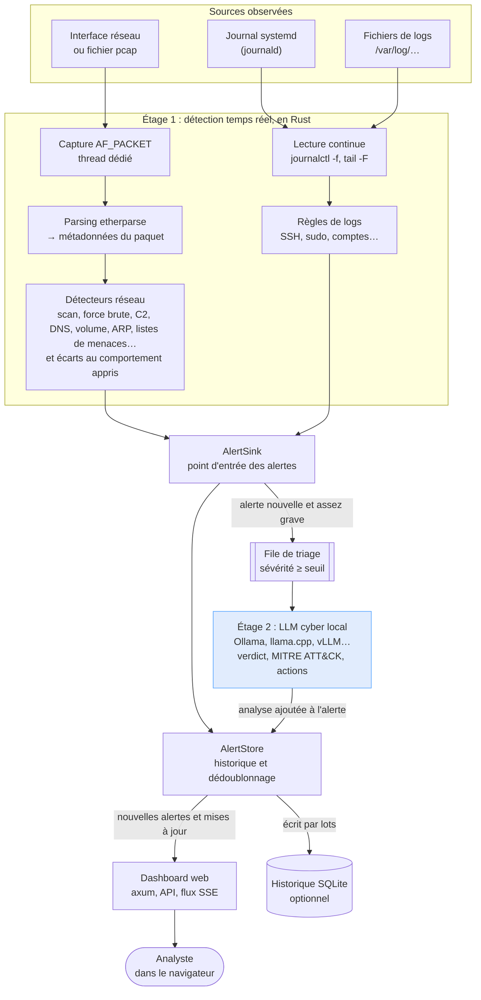

# Principe de fonctionnement

Le système fonctionne en deux étages.

**Étage 1 : détection rapide, en Rust.** Chaque paquet est réduit à ses métadonnées : adresses, ports, drapeaux TCP, taille, nom DNS demandé et, pour l'ARP, l'adresse MAC annoncée. Le contenu n'est jamais conservé. Des détecteurs statistiques et à seuils traitent ces métadonnées au fil de l'eau. En parallèle, les journaux système sont lus en continu et comparés à des règles. Cet étage traite des dizaines de milliers de paquets par seconde sur un CPU ordinaire.

**Étage 2 : analyse par un modèle de langage.** Les alertes dont la sévérité dépasse un seuil, `medium` par défaut, sont envoyées une par une au modèle. Il reçoit l'alerte, ses preuves et les autres alertes récentes impliquant les mêmes adresses. Il renvoie :

- un verdict : malveillant, suspect ou bénin ;
- un indice de confiance ;
- une explication en langage clair ;
- les techniques MITRE ATT&CK correspondantes ;
- des recommandations concrètes.

**Pourquoi ne pas tout envoyer au modèle ?** Un modèle de 8 milliards de paramètres sur CPU produit quelques mots par seconde. Il ne peut pas suivre un flux de paquets. En revanche, il excelle à contextualiser une alerte déjà isolée : faire le lien entre un scan et une force brute venant de la même IP, distinguer une sauvegarde nocturne d'une exfiltration, proposer une réponse. La détection reste donc temps réel, et l'IA apporte le jugement.
